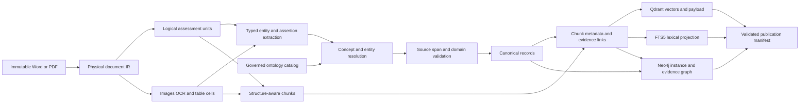
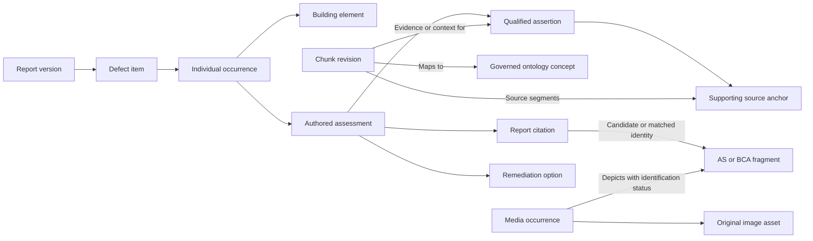

# Document Structure Chunk Metadata and Graph Construction

Version 1.0  
Date 12 October 2026  
Status Normative engineering design for implementation  
System and orchestration [SPEC.md](SPEC.md)  
Domain meanings [ONTOLOGY.md](ONTOLOGY.md)  
Delivery tasks [TASKS.md](TASKS.md)

## Pipeline contract

The pipeline preserves the document before interpreting it. It creates an ordered physical document representation, identifies logical assessment units, extracts source-supported domain records, builds bounded retrieval chunks and projects the same canonical identities into the search indexes and evidence graph.

**There is one governed application ontology.** We do not create an ontology for every chunk. Extracted entities/assertions instantiate that ontology; chunk-to-concept, chunk-to-entity and chunk-to-assertion links make those records discoverable and traceable.



Extraction operates on logical assessment sections with their parent context, not on isolated embedding windows. Chunking is a retrieval representation of those sections, not a replacement for the document or its domain records. When model extraction is unavailable, publish structurally valid source chunks as partial knowledge with unresolved domain associations; resume enrichment later.

## Stored representations and ownership

| Representation | Stored in | Purpose and authority |
|---|---|---|
| Original document and original embedded assets | Managed local asset files; identity/checksum in SQLite. | Immutable evidence. Downloads/previews resolve by managed asset ID. |
| Raw parser output | Versioned derived files, including Docling JSON and OOXML relationship inventory. | Reproduce/debug a parser result; it is not the canonical domain database. |
| DocumentIR | Schema-validated versioned JSON asset and indexed block rows in SQLite. | Physical order, hierarchy, tables, pictures, captions and exact source locations. |
| Logical units and domain enrichment | SQLite, linked to physical blocks and a semantic revision. | Defect items/occurrences, role-labelled sections, entities, assertions and scope. |
| Chunks and metadata | Immutable ChunkRevision records, ordered source segments and normalized join tables in SQLite. | Canonical retrieval/evidence identities and source mappings. |
| Lexical and vector projection | FTS5 and Qdrant, keyed by canonical chunk revision and projection revision. | Search accelerators; not the source of truth for context or applicability. |
| Domain and evidence projection | Neo4j, keyed by canonical IDs plus projection revision. | Bounded traversal of entities, assertions, concepts, chunks and source evidence. |
| LangGraph checkpoints | PostgreSQL workflow database. | Workflow execution state referencing canonical records; not a second document/entity catalog. |

File layout uses managed IDs, not untrusted filenames:

~~~text
originals/<asset-hash>/<original-file>
media/<asset-hash>/<original-image>
derived/<document-version>/<structure-revision>/document.ir.json
derived/<document-version>/<structure-revision>/parser-output.json
derived/<media-occurrence>/<visual-extraction-revision>/ocr-layout.json
derived/<media-occurrence>/<preview-revision>/preview.png
derived/embeddings/<embedding-profile>/<retrieval-text-hash>.npy
~~~

Original filenames remain descriptive catalog fields. Every derived asset records its input IDs/hashes, method/profile and output checksum. Embedding cache reuse requires both the text hash and exact embedding profile; semantic metadata corrections cannot cause reuse of a vector for different retrieval text.

## Physical document structure

DocumentIR is an ordered tree of source blocks with explicit cross-links. Node kinds include document/part root, heading, paragraph, list item, table, row, cell, picture occurrence, caption, header/footer, text box and page region. Word/PDF adapters produce this common shape while retaining format-specific source locators.

For DOCX, retain XML part/XPath, paragraph ordinal, table/row/cell path, heading/list numbering, picture relationship and crop information. Traverse paragraphs and tables together in order; text inside tables/text boxes must not disappear. Floating figures retain their anchor paragraph and a reading-order uncertainty where positioning is ambiguous. Headers/footers have their own scope.

For PDF, retain zero-based page index, printed page label if established, native/OCR provenance, reading order, page box/rotation, raw source bounds and normalized display bounds. Table rows/cells keep spans and merged-header associations. PDFium source-region rendering preserves vector labels and annotations that an extracted raster alone would omit.

Keep native source text unchanged. Search normalization is a separate value; it must not shift citation offsets or turn corrected OCR into original wording. Text offsets are zero-based Unicode code-point offsets with an exclusive end. OCR words/cells also have source-region bounds. Browser highlights convert code-point offsets to JavaScript/DOM UTF-16 offsets explicitly; test non-BMP and combining-character text rather than slicing source strings with incompatible offsets.

### DocumentIR example

This shortened example uses symbolic IDs for readability. Production IDs are generated under the identity rules below. The standard figure identity/printed page are observable in the supplied sample; the example is a proposed record shape, not a claim that an implemented importer has produced it.

```json
{
  "schema_version": "document-ir/1",
  "document_version_id": "example-report-v1",
  "structure_revision_id": "example-structure-r1",
  "original_asset_id": "example-docx-asset",
  "parser_profile_id": "docx-ordered-v1",
  "root_block_ids": ["section-planter"],
  "blocks": [
    {
      "block_id": "section-planter",
      "kind": "heading",
      "parent_block_id": null,
      "order_key": [4],
      "text": "Planter Box Membrane",
      "child_block_ids": ["picture-figure-217", "paragraph-reasoning"],
      "locator_id": "example-heading-locator"
    },
    {
      "block_id": "paragraph-reasoning",
      "kind": "paragraph",
      "parent_block_id": "section-planter",
      "order_key": [4, 2],
      "text": "The membrane does not extend above the soil line.",
      "extraction_kind": "native_text",
      "locator_id": "example-paragraph-locator"
    },
    {
      "block_id": "picture-figure-217",
      "kind": "picture_occurrence",
      "parent_block_id": "section-planter",
      "order_key": [4, 1],
      "media_occurrence_id": "example-figure-occurrence",
      "asset_id": "example-original-figure-asset",
      "locator_id": "example-picture-locator"
    }
  ]
}
```

The full schema additionally includes document part, source locator records, heading paths, tables/cells, caption links, extraction warnings and asset references. A picture association supported only by proximity remains a candidate relationship. Physical storage must preserve a figure even if its defect association is unresolved.

### Locator contract

| Locator | Required fields |
|---|---|
| DOCX text/drawing | document version, XML part, actual XPath, paragraph ordinal or table/cell path, optional text range, heading path and drawing relationship when relevant. |
| PDF text/region | document version, page index, raw bbox/origin, crop/media box, rotation and normalized display bbox; printed report page label is optional. |
| Embedded reference extract | containing report locator and media occurrence, identified source edition/fragment candidates, visible printed source page and identification evidence. |

A figure showing printed AS page 30 inside Word does not make it Word page 30. PDF display normalization is recorded alongside original coordinates and tested against rotated/cropped pages before highlight overlays are accepted.

## Logical assessment units

Logical units map physical blocks into meaningful research boundaries. Their membership is explicit and versioned; they do not modify the original DocumentIR.

| Unit kind | Scope |
|---|---|
| defect_item | An authored topic such as Planter Box Membrane, with child occurrences and shared sections. |
| occurrence_observation | One DS/location occurrence and the observations/photographs supported for it. |
| reasoning, result, extent, status, responsibility | Role-labelled assessment sections, with supported item/occurrence scope. |
| remediation_option | One complete repair alternative and its prerequisites/limitations/ordered steps. |
| reference_clause or definition | A source provision with parent hierarchy, conditions, exceptions and dependent fragments. |
| reference_table or reference_figure | The full table/figure plus headers/caption/notes and source identity candidates. |
| drawing_detail or approval_evidence | The relevant detail/certificate statement with document/version and scope. |

Use heading styles, numbering, template markers and table structure first. Model proposals can resolve ambiguous role/boundary cases, but their source memberships must validate. A shared reasoning section links to supported occurrences through explicit scope records; it is not copied as an occurrence-specific statement without evidence.

Store a ParentContext for the full unit, ordered block membership and dependency IDs. A child search result can fetch the parent and adjoining required definitions/notes. Parent context has no embedding-size restriction; model assembly still enforces its budget and withholds unsupported claims if complete required context cannot fit.

## Chunking algorithm

The baseline is structure-aware parent/child chunking using the BGE tokenizer. Chunks target 300–420 tokens, with a hard limit of 480 tokens for the **entire retrieval text**, including its context header. The model has a 512-token limit; the remaining margin prevents accidental truncation. These are initial tunable settings evaluated against company fixtures.

1. Load the validated physical structure and logical units for a document revision.
2. Create a parent record for each supported unit and register required source/fragment dependencies.
3. Select atomic content according to the unit kind: paragraphs/sentences, numbered subclauses, ordered repair steps, table row groups, or image OCR/description blocks.
4. Build a short retrieval header from sourced item/section/identifier context. The header is discovery context, not a verbatim quotation. Count its tokens before packing content.
5. Pack consecutive atoms only within the same unit, section purpose, source-text kind and remediation option. Stop at 420 tokens where possible; never exceed 480 total.
6. If one atom is too long, split at sentences or numbered subclauses and retain exact source ranges. For a residual long sentence, split tokenizer windows with offset mapping while retaining the original parent and declaring the split.
7. Use no overlap between complete paragraph/subclause units. Only a split long atom may repeat up to 30 trailing tokens; label those repeated source spans as overlap. Never overlap across occurrences or repair alternatives.
8. Persist ordered segments, raw evidence/body, introduced header, retrieval text/hash, token counts, dependencies and metadata revision.
9. Associate concepts, entities and assertions by their supported spans/scope; do not infer metadata from embedding similarity.
10. Validate coverage, offsets, ownership, token limit and hashes, then create lexical/vector/graph projection revisions.

### Rules by content type

| Content | Boundary and packing rule | Context retained |
|---|---|---|
| Short occurrence/observation | Keep it as one chunk even when far below 300 tokens. Do not pad with another occurrence. | Item, DS/location identifiers, photographs and source spans. |
| Reasoning/status/result | Group consecutive paragraphs of one role and supported scope; split long paragraphs as above. | Full assessment unit, cause/requirement assertions and source dependencies. |
| Remediation | Chunk one option's ordered step groups; preserve step range and prerequisite/limitation dependencies. | Full option and alternative group. Different options are never packed together. |
| Code/AS clause | Prefer numbered subclauses as atoms; separate discovery chunks can be smaller than the entire clause. | Full clause, parent, definitions, exceptions, notes and scoped reference call-up. |
| Table | Group complete rows with their exact column/merged-header context; preserve cell coordinates and notes. | Full table structure and original table image when present. |
| Large table/header | Split by supported row/column groups. Oversized headers become linked context chunks; a concise embedding serialization cannot replace their originals. | Required full headers/notes are fetched before interpreting a cell. |
| Figure/drawing | Index native caption, image OCR and model/reviewed description as separately typed chunks linked to one visual context. | Original asset/region, labels/notes, source identity and report reasoning. |
| Test/measurement | Keep value, units, method and qualifier together where recorded. | Original display/text and uncertainty; no invented percent/unit conversion. |

Table serialization is derived retrieval text even when it uses original cell values. Diagram descriptions are model/review-derived content. Neither can be cited as verbatim original wording. Do not discard empty/poor OCR figures: retain the visual occurrence and make any available caption/source identifier searchable.

### Implementation pseudocode

```python
for unit in validated_units:
    parent_id = store_parent_context(unit)
    atoms = build_atoms(unit, keep_rows_steps_and_units=True)
    header = build_sourced_retrieval_header(unit)
    children = pack_atoms(atoms, header, target=420, hard_limit=480)
    for child in children:
        assert same_scope_and_content_kind(child)
        assert exact_source_segments_exist(child.segments)
        assert bge_token_count(child.retrieval_text) <= 480
        assert source_text_matches_spans(child)
        record = persist_immutable_chunk(child, parent_id)
        attach_supported_semantic_links(record, unit.semantic_revision)
    assert all_eligible_source_spans_are_covered(unit, children)
```

This is an algorithm contract. It deliberately requires source-range and coverage checks beyond a generic recursive text splitter.

## Chunk identity and metadata

Canonical metadata is maintained in SQLite. A chunk's semantic annotations are normalized links, not an arbitrary dictionary editable inside Qdrant. Qdrant and FTS receive versioned projections assembled from those records.

Use two identity levels. Chunk identity derives from document version, physical/semantic structure revision, logical unit, content kind, ordered source segments and chunker profile. An immutable ChunkRevision adds retrieval text/hash, metadata/annotation revision and dependency membership. Vector point identity derives from chunk revision, embedding profile and projection revision. Keep the logical unit/source mapping so later split/merge revisions remain traceable.

| Metadata group | Required values and rules |
|---|---|
| Identity | chunk ID/revision, document/structure/semantic revisions, logical unit/parent context, chunker profile and content/retrieval hashes. |
| Source | source role, authority role, native/OCR/table/description kind, parser/extraction profile, language and source anchors/segments. |
| Structural scope | heading path, section purpose, item ID, supported occurrence IDs, option ID/step range where relevant, sequence and dependency IDs. |
| Visual context | media occurrence/asset IDs, OCR/description revision IDs, crop/omission warnings and identified fragment candidates. |
| Domain mappings | versioned concept links, entity mentions and supporting assertion IDs, each with method/evidence/review status. |
| Project context | recorded project/building/part/location IDs and source-backed context assertion links where established; unknown values remain absent. |
| Reference context | report-cited reference IDs and separately identified source edition/volume/part/year/amendments/fragment. Identification and original-source verification remain distinct. |
| Retrieval/publication | actual tokenizer counts, embedding profile, vector/content hashes, projection revision and readiness/coverage. |

A report's stated BCA year is an assertion, not a governing eligibility field for all of its chunks. A snapshot's identified AS year describes the depicted source, not its applicability to every project. Current-project applicability is evaluated at query time against a context/decision and must not overwrite historical chunk metadata.

### Canonical chunk example

The body below is a sentence in the sample's planter reasoning. IDs are symbolic. Source ownership and report-local context must be resolved by the importer; no classification or adoption decision is invented in this example.

```json
{
  "schema_version": "chunk/1",
  "chunk_id": "example-planter-reasoning-child",
  "chunk_revision_id": "example-chunk-r1",
  "document_version_id": "example-report-v1",
  "structure_revision_id": "example-structure-r1",
  "semantic_revision_id": "example-semantic-r1",
  "logical_unit_id": "example-planter-reasoning-unit",
  "parent_context_id": "example-planter-reasoning-parent",
  "source_role": "company_report",
  "authority_role": "report_author_statement",
  "content_kind": "native_text",
  "section_path": ["EXTERNAL DEFECTS", "Planter Box Membrane", "Reasoning"],
  "section_purpose": "reasoning",
  "defect_item_id": "example-planter-item",
  "occurrence_ids": [],
  "raw_body": "The membrane does not extend above the soil line.",
  "source_segments": [
    {"block_id": "paragraph-reasoning", "start_cp": 0, "end_cp": 49, "role": "body"}
  ],
  "retrieval_header": "Planter Box Membrane | Reasoning",
  "retrieval_text": "Planter Box Membrane | Reasoning\nThe membrane does not extend above the soil line.",
  "concept_links": [
    {"concept_id": "defect.membrane_termination", "basis": "source_supported_mapping", "review_state": "extracted"}
  ],
  "assertion_ids": ["example-authored-design-assessment"],
  "cited_reference_ids": ["example-report-as4654-reference"],
  "classification_assertion_ids": [],
  "media_occurrence_ids": [],
  "dependency_ids": ["example-figure-217-context"],
  "extraction_review_state": "extracted",
  "chunker_profile_id": "structure-bge-v1"
}
```

The paragraph is item-level reasoning, so occurrence_ids is empty until an explicit supported scope link associates it with particular occurrences. A linked figure appears through dependencies; it is not falsely labelled an image embedded in that paragraph. Token counts/hashes are computed during implementation, never copied from an illustrative example. A governing applicability decision belongs to the query's evidence/claim context, not this reusable historical chunk record.

### Search payload projection

The Qdrant payload contains canonical IDs, revision, source/content role, indexed scope fields and selected resolved identifiers. It does not own raw block hierarchy, complete evidence text, rule truth or editable business facts.

```json
{
  "chunk_revision_id": "example-chunk-r1",
  "document_version_id": "example-report-v1",
  "projection_revision_id": "example-projection-r1",
  "source_role": "company_report",
  "content_kind": "native_text",
  "section_purpose": "reasoning",
  "logical_unit_id": "example-planter-reasoning-unit",
  "defect_item_id": "example-planter-item",
  "concept_ids": ["defect.membrane_termination"],
  "occurrence_ids": [],
  "identified_reference_edition_ids": [],
  "cited_reference_ids": ["example-report-as4654-reference"],
  "embedding_profile_id": "bge-base-en-v1_5-locked-revision",
  "retrieval_text_hash": "computed-during-ingestion",
  "metadata_hash": "computed-during-ingestion"
}
```

Create payload indexes for revision/document/source/content kinds, concepts, item/occurrence/part IDs and identified reference IDs used in filters. FTS rows join the same canonical chunk revision/manifest members. Result IDs are hydrated from SQLite to fetch original spans, parent context, semantic status and media. A stale payload/receipt is a publication failure, not permission to improvise missing metadata.

## Ontology mapping and entity extraction

The governed catalog defines entity/concept families, permitted predicates, aliases, source-backed definition versions and subject/object constraints. Examples include BuildingPart, BuildingClass, ConcreteFinishClass, MembraneClass, Element, DefectOccurrence, Observation, AuthoredReasoning, RemediationOption, ReferenceEdition and ReferenceFragment.

Extraction produces **instances and assertions** under those definitions:

1. Identify explicit source mentions in logical units using structural rules, exact identifiers and structured model extraction.
2. Resolve each mention to known concept candidates using family/type and context. Class 2 in concrete-finish reasoning must resolve to a finish concept, not a building classification.
3. Mint document-scoped entity candidates or match established canonical entities using reviewed identity evidence. Repeated DS numbers or an identical personal name do not justify global merging.
4. Extract only allowed predicates with subject/object IDs or typed literal values, exact supporting block ranges/media anchors, assertion kind and scope.
5. Validate that the evidence exists, quoted ranges match, IDs belong to the allowed source context, and domain/predicate constraints hold. Unsupported links stay proposals/review items.
6. Attach chunk links by overlap with those supporting spans or explicit shared-unit scope. Overlap is evidence-location association, not proof of causation or applicability.
7. Publish extracted report statements with their attributed/extracted status for research. Verify/review original normative references and rule premises separately before enabling governing claims.

New terminology produces a candidate-term queue. A reviewer can add an alias/concept/definition to a new catalog release. The model cannot create a new ontology class for each passage, change the class hierarchy or activate adoption rules automatically.

| Link record | What it means |
|---|---|
| EntityMention | This source span mentions this entity/candidate; includes source offsets, extraction method and resolution state. |
| ChunkConceptLink | This chunk is associated with a known concept under a particular catalog/review version. |
| ChunkEntityLink | This chunk contains/supports a mention or explicit scope relationship to this entity. |
| ChunkAssertionLink | This chunk includes evidence or required context for a source-backed assertion; records direct-evidence versus context role. |

Catalog/version changes invalidate affected mappings. Re-embed only when retrieval text/profile changes; metadata-only updates still require consistent payload/graph/FTS publication. Existing source text and historical assertions remain immutable.

## Knowledge graph construction

Neo4j is a projection of validated canonical records. It is not constructed by asking a model to generate arbitrary Cypher, and it is not only a chain of similar chunks.

### Projection stages

1. Create source/version/section/unit/anchor/media nodes required by the published evidence slice.
2. Project ontology concepts and definition-version IDs from the governed catalog.
3. Project canonical project/building/part/location/element and item/occurrence/entity records with their identity scope.
4. Project assertion nodes containing predicate, kind, scope, status and source/premise IDs. Connect subjects/objects and supporting anchors explicitly.
5. Project reference edition/fragment nodes and reported or verified reference-relationship assertions. Their basis/scope/verification remains inspectable.
6. Project remediation options, alternative groups, work events, cause/consequence and responsibility assessments.
7. Project lightweight ChunkRevision nodes and concept/entity/assertion/evidence links; complete text and vectors remain in their owning stores.
8. Validate all IDs, ownership, permitted predicates and supporting evidence, then write a projection receipt for manifest activation.



### Neo4j write contract

Projection keys include canonical ID and projection revision. Use uniqueness constraints and parameterized MERGE, not whole-database deletion. The following illustrative batch writes assertion support; every parameter row must have passed canonical validation first.

```cypher
UNWIND $rows AS row
MERGE (s:Entity {projection_key: row.subject_key})
  ON CREATE SET s.canonical_id = row.subject_id,
                s.projection_revision_id = row.projection_revision_id
MERGE (a:Assertion {projection_key: row.assertion_key})
  ON CREATE SET a.canonical_id = row.assertion_id,
                a.predicate_id = row.predicate_id,
                a.kind = row.kind,
                a.review_state = row.review_state,
                a.projection_revision_id = row.projection_revision_id
MERGE (e:SourceAnchor {projection_key: row.anchor_key})
  ON CREATE SET e.canonical_id = row.anchor_id,
                e.projection_revision_id = row.projection_revision_id
MERGE (a)-[:HAS_SUBJECT]->(s)
MERGE (a)-[:SUPPORTED_BY]->(e)
```

The example omits object/premise/media links for brevity. Production batches cannot mint missing subject/anchor records from invented model IDs: prevalidation and source-node receipts must establish them. Other labels/relationships follow application-owned templates. Query results return qualified assertion IDs and provenance, not unqualified shortcuts as proof.

A reported AS citation can point to an identified fragment candidate without a verified adoption edge. Complete original sources and reviewed chain rules are required for the latter. Similarity may nominate comparable occurrences but cannot create factual relationships such as caused_by, classified_as or adopted_standard.

## Core relational persistence schema

These DDL excerpts define the important structural/chunk boundaries. They are design examples to be implemented through Alembic, not executed against an existing app. Referenced document/domain/asset/projection tables are defined by the canonical model in SPEC.md.

```sql
CREATE TABLE structure_revisions (
  id TEXT PRIMARY KEY,
  document_version_id TEXT NOT NULL REFERENCES document_versions(id),
  parser_profile_id TEXT NOT NULL,
  ir_asset_id TEXT NOT NULL REFERENCES assets(id),
  schema_version TEXT NOT NULL,
  content_hash TEXT NOT NULL,
  state TEXT NOT NULL CHECK (state IN ('staged','validated','failed')),
  UNIQUE (id, document_version_id)
);

CREATE TABLE source_blocks (
  id TEXT PRIMARY KEY,
  document_version_id TEXT NOT NULL,
  structure_revision_id TEXT NOT NULL,
  parent_block_id TEXT,
  kind TEXT NOT NULL,
  order_key_json TEXT NOT NULL,
  source_text TEXT,
  extraction_kind TEXT NOT NULL,
  locator_json TEXT NOT NULL,
  payload_json TEXT NOT NULL,
  UNIQUE (id, document_version_id, structure_revision_id),
  FOREIGN KEY (structure_revision_id, document_version_id)
    REFERENCES structure_revisions(id, document_version_id),
  FOREIGN KEY (parent_block_id, document_version_id, structure_revision_id)
    REFERENCES source_blocks(id, document_version_id, structure_revision_id)
);

CREATE TABLE logical_units (
  id TEXT PRIMARY KEY,
  document_version_id TEXT NOT NULL,
  structure_revision_id TEXT NOT NULL,
  semantic_revision_id TEXT NOT NULL,
  kind TEXT NOT NULL,
  parent_context_id TEXT NOT NULL REFERENCES parent_contexts(id),
  scope_state TEXT NOT NULL,
  FOREIGN KEY (structure_revision_id, document_version_id)
    REFERENCES structure_revisions(id, document_version_id)
);

CREATE TABLE unit_blocks (
  unit_id TEXT NOT NULL REFERENCES logical_units(id),
  block_id TEXT NOT NULL REFERENCES source_blocks(id),
  sequence_no INTEGER NOT NULL,
  role TEXT NOT NULL,
  PRIMARY KEY (unit_id, sequence_no)
);

CREATE TABLE chunks (
  id TEXT PRIMARY KEY,
  unit_id TEXT NOT NULL REFERENCES logical_units(id),
  content_kind TEXT NOT NULL,
  chunker_profile_id TEXT NOT NULL,
  source_identity_hash TEXT NOT NULL UNIQUE
);

CREATE TABLE chunk_revisions (
  id TEXT PRIMARY KEY,
  chunk_id TEXT NOT NULL REFERENCES chunks(id),
  annotation_revision_id TEXT NOT NULL,
  raw_body TEXT NOT NULL,
  retrieval_header TEXT NOT NULL,
  retrieval_text TEXT NOT NULL,
  retrieval_text_hash TEXT NOT NULL,
  metadata_json TEXT NOT NULL,
  metadata_hash TEXT NOT NULL,
  token_counts_json TEXT NOT NULL,
  schema_version TEXT NOT NULL
);

CREATE TABLE chunk_segments (
  chunk_revision_id TEXT NOT NULL REFERENCES chunk_revisions(id),
  sequence_no INTEGER NOT NULL,
  block_id TEXT NOT NULL REFERENCES source_blocks(id),
  start_cp INTEGER NOT NULL CHECK (start_cp >= 0),
  end_cp INTEGER NOT NULL CHECK (end_cp > start_cp),
  role TEXT NOT NULL CHECK (role IN ('body','header_context','overlap','note_context')),
  PRIMARY KEY (chunk_revision_id, sequence_no)
);

CREATE TABLE chunk_concepts (
  chunk_revision_id TEXT NOT NULL REFERENCES chunk_revisions(id),
  concept_id TEXT NOT NULL REFERENCES concepts(id),
  catalog_version_id TEXT NOT NULL,
  mapping_assertion_id TEXT NOT NULL REFERENCES assertions(id),
  PRIMARY KEY (chunk_revision_id, concept_id, mapping_assertion_id)
);

CREATE TABLE chunk_assertions (
  chunk_revision_id TEXT NOT NULL REFERENCES chunk_revisions(id),
  assertion_id TEXT NOT NULL REFERENCES assertions(id),
  evidence_role TEXT NOT NULL CHECK (evidence_role IN ('direct','context')),
  PRIMARY KEY (chunk_revision_id, assertion_id, evidence_role)
);

CREATE INDEX source_blocks_document_structure
  ON source_blocks(document_version_id, structure_revision_id);
CREATE INDEX chunk_revisions_text_hash ON chunk_revisions(retrieval_text_hash);
CREATE INDEX chunk_concepts_reverse ON chunk_concepts(concept_id, chunk_revision_id);
CREATE INDEX chunk_assertions_reverse ON chunk_assertions(assertion_id, chunk_revision_id);
```

All JSON fields validate against named Pydantic schemas before insert. Application/triggers additionally enforce same-document/structure unit memberships, end offsets within source text, supported external/shared scope, parent hierarchy acyclicity, segment coverage and metadata equality with normalized records. The excerpt must not be mistaken for proof that all those constraints are expressible through foreign keys alone.

## Worked example from the report

For Planter Box Membrane, the physical structure contains the item heading, individual DS/location findings and photographs, assessment sections, original standard extracts/drawings and remediation list. The embedded figure identifies AS 4654.2-2012 Figure 2.17 and printed source page 30.

The logical representation creates a parent defect item, separate occurrences such as the Ground Floor Rear Garden Planter Box DS-68 finding, a shared reasoning unit, the figure context and a remediation option. It preserves which observation is associated with each site photograph and whether shared reasoning is explicitly scoped.

The chunker creates short occurrence chunks, role-specific reasoning children, separate figure-caption/OCR/description chunks and step-group remediation chunks. Each points back to its source segments and full parent. The ontology mapper associates membrane termination/drainage/water ingress concepts with the relevant mentions and preserves authored reasoning as opinion/assessment rather than a newly observed physical fact.

The graph connects occurrences, elements, reasoning assertions, source anchors, report references, the original figure occurrence and repair scope. It does not claim that the depicted AS edition governs the current building merely because the graph contains that figure.

For a query about planter waterproofing, hybrid search finds child chunks; graph traversal collects their reasoning/figure/repair links; the evidence assembler fetches complete required parent/fragment context and displays the preserved image. A current-building question then invokes the separate classification/edition/reference decision using project facts and reviewed rules.

## Publication and corrections

Validate each document projection revision against canonical chunk IDs/counts, hashes, semantic links and source coverage. FTS, Qdrant and Neo4j must have matching receipts before a new manifest becomes active. The LangGraph checkpoint references the published manifest; it cannot act as the publication authority.

A corrected OCR word creates a new visual extraction and dependent chunk revision. A changed source association creates new semantic/mapping revisions. A new ontology alias creates a catalog/mapping update. A changed segmentation profile creates new chunk identities with parent/source lineage. Every change republishes affected projections and invalidates dependent decisions/answers; unchanged input hashes can reuse expensive parser/model/embedding results.

Keep originals, structured documents, canonical links and saved answer evidence after derived index cleanup. Rebuilding indexes from those sources must reproduce the same resolvable citation and figure identities.

## Required validation

- Every source text range is valid and reproduces the recorded body, with introduced header/description text separately identified.
- Every eligible span in a logical unit is covered by a chunk or explicit non-indexed/failed reason; overlap does not count as extra occurrences.
- Every embedding input is counted with the actual model tokenizer and stays within the hard limit without silent truncation.
- Chunks do not cross occurrence/option/content-kind boundaries, and complete clause/table context remains fetchable.
- Metadata, normalized links and search/graph payloads agree under the same projection/manifest revision.
- Entity/concept/relationship IDs resolve to allowed schema/catalog versions, with source support and no inference of applicability from chunk tags.
- Ambiguous class terms, cropped year identifiers and repeated DS numbers retain uncertainty/collision state.
- Replayed LangGraph nodes create no duplicate entities/occurrences or independent competing source identities.
- Sample Figure 2.17 retrieval resolves the original image and report context through exact, text/semantic and graph paths.

These checks become TC55–TC64 in ACCEPTANCE_TESTS.md and tasks T43–T48 in TASKS.md. They are implementation acceptance contracts, not test results from a built application.
