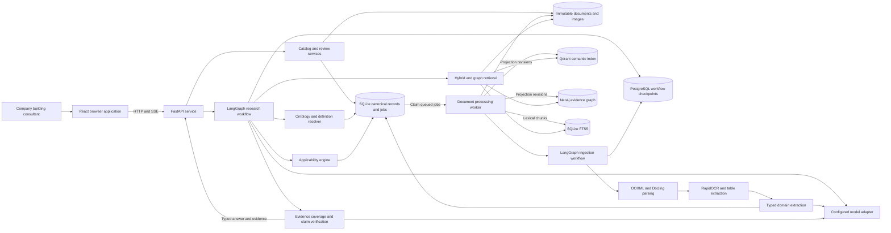
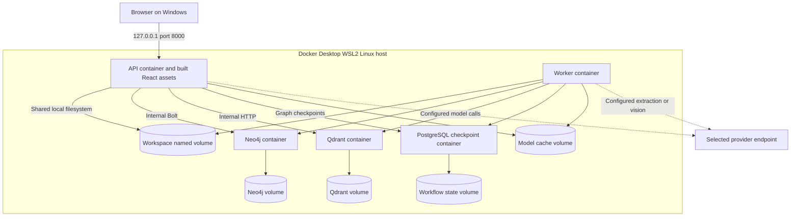
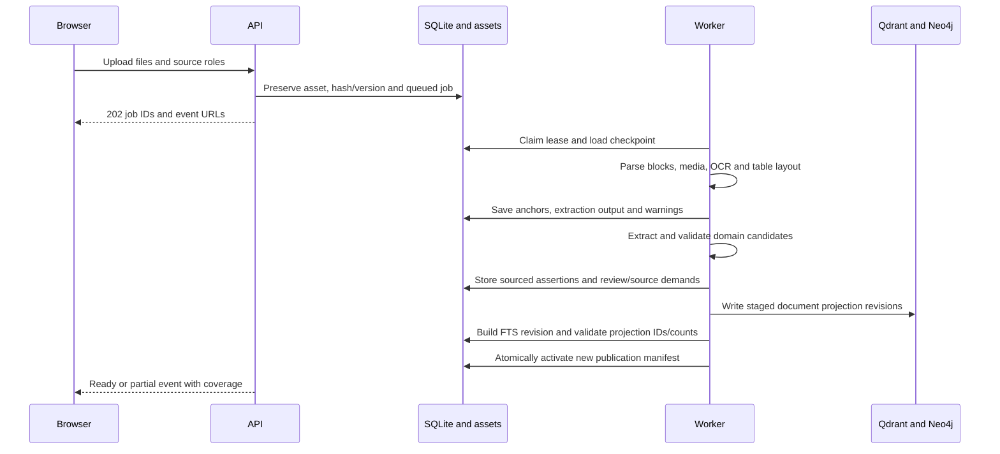
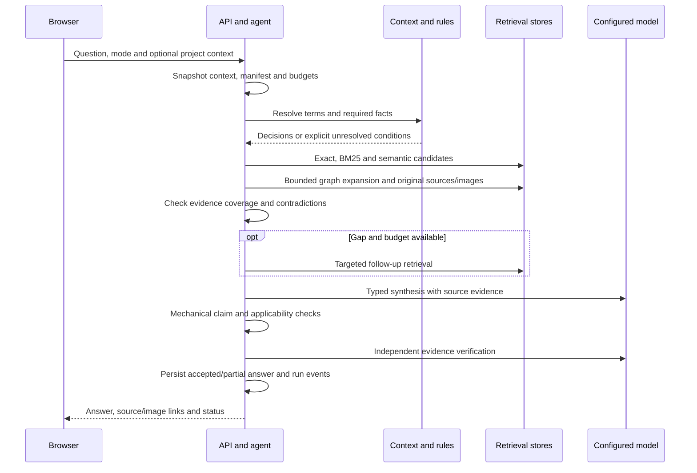
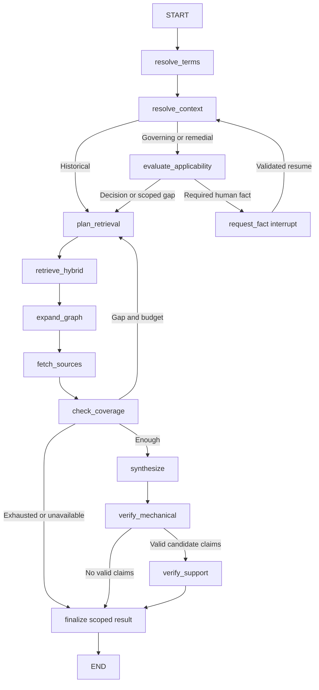

# Defect Intelligence Technical Specification

Version 3.0  
Date 12 October 2026  
Status Proposed implementation specification  
Product requirements [PRD.md](PRD.md)  
Domain ontology [ONTOLOGY.md](ONTOLOGY.md)  
Ordered implementation tasks [TASKS.md](TASKS.md)  
Document and chunk contracts [DATA_PIPELINE.md](DATA_PIPELINE.md)

This specification defines the selected implementation stack, service boundaries, data flows, processing algorithms, API/UI contracts and operational design. These are design decisions for the new application, not a statement that the listed services are already implemented or installed.

## Navigation

- [System design](#system-design) and [selected technology stack](#selected-technology-stack).
- [Document to knowledge contract](#document-to-knowledge-contract) and [detailed data pipeline](DATA_PIPELINE.md).
- [Local deployment and configuration](#local-deployment-and-configuration) and [processing and query flows](#processing-and-query-flows).
- [Canonical identity and data model](#canonical-identity-and-data-model) and [report and reference ingestion](#report-and-reference-ingestion).
- [Ontology](#ontology-design), [knowledge graph](#knowledge-graph-design) and [applicability engine](#applicability-engine).
- [Hybrid and graph retrieval](#hybrid-and-graph-retrieval), [evidence contract](#common-evidence-contract) and [agent execution](#agent-tools-and-execution).
- [Verification](#synthesis-and-verification), [API and UI contracts](#api-and-ui-contracts) and [publication and recovery](#publication-consistency-and-recovery).
- [Application structure](#proposed-application-structure), [implementation validation](#implementation-sequence-and-validation) and [ordered tasks](TASKS.md).

## System contract

Build one local research application with five cooperating capabilities:

1. A source catalog containing immutable company reports, original reference documents, their versions and embedded visual evidence.
2. A building ontology defining domain concepts, aliases, distinct classification systems and versioned relationships as specified in ONTOLOGY.md.
3. An evidence graph connecting actual projects, building parts, defect items and individual occurrences, observations, reasoning, versioned references, images, repair history and remediation options.
4. An applicability engine executing reviewed rules against project facts and the reference catalog.
5. An agent using hybrid search, graph traversal and exact source retrieval to answer and verify research questions.

The graph and ontology are part of the first complete release. They are used for meaning, relationships and applicability; hybrid retrieval finds supporting passages. An embedding match or graph path is insufficient by itself to endorse a governing requirement.

All requirements below apply within the product's declared jurisdiction, edition and reference coverage. A coverage gap is an explicit result. The source library can grow from the editions required by the pilot reports; importing every historical BCA/NCC edition is not a prerequisite for historical research.

## Document to knowledge contract

The executable workflow engine is **LangGraph**. Use a StateGraph for ingestion and a StateGraph for research, with PostgreSQL checkpoints, typed application nodes and explicit conditional edges. LangChain Core supplies compatible Document/tool interfaces; the OpenAI SDK remains a provider adapter, not the workflow engine. LangGraph supports controlled combinations of deterministic and model-driven steps, persistence, streaming and interrupts. These capabilities fit the required retrieval loops and source/applicability gates. [LangGraph overview](https://docs.langchain.com/oss/python/langgraph/overview)

| Question | Implementation decision |
|---|---|
| How is a document structured and stored? | Preserve original bytes; store a versioned DocumentIR ordered tree of headings, paragraphs, tables/cells, media/captions and source locators. Store indexed block rows in SQLite and full IR JSON as a managed asset. Logical assessment units/enrichment are separate versioned records. |
| How is it chunked? | Create full parent contexts by assessment/requirement unit, then tokenizer-bounded child chunks within occurrence, role, repair option and source-text-kind boundaries. Tables and figures have specialised representations. No silent truncation. |
| How is chunk metadata handled? | Canonical immutable ChunkRevision plus source segments and normalized concept/entity/assertion links in SQLite. Publish matching payload/FTS/graph projections with checksums under one manifest. |
| How is ontology created for chunks? | Maintain one governed schema/catalog. Extract instances/assertions and map supported mentions/spans to that catalog; annotate chunks with those IDs. Do not create per-chunk ontologies or infer building class from a similar passage. |
| How is the graph created? | Validate canonical entities, qualified assertions, references and source support, then use application-owned parameterized MERGE batches. Project chunks as evidence links, not as a substitute for the domain graph. |
| How is a result assembled? | Find child chunks, expand through qualified graph relationships, fetch parent/source dependencies and original visuals, then evaluate applicability and verify each claim. |

The full schemas, per-content chunk algorithm, metadata examples, relational DDL, ontology mapping rules and graph write example are normative in [DATA_PIPELINE.md](DATA_PIPELINE.md). The contracts below use the same IDs and revisions.

## System design



### Service responsibilities and boundaries

| Component | Owns | Must not do |
|---|---|---|
| Browser application | Import forms, question/context controls, search, evidence/graph viewers, review and settings. | Connect directly to Neo4j/Qdrant, hold provider secrets or determine code applicability. |
| FastAPI service | Validated API, local session, catalog mutations, async research runs, SSE events and managed-asset serving. | Perform document OCR/layout processing inside request handlers or expose unrestricted model-generated queries. |
| Processing worker | Admit/lease import jobs, execute the LangGraph ingestion graph, materialize source/semantic/chunk outputs and publish projections. | Duplicate graph transition/checkpoint logic in the job scheduler or delete the library on import. |
| Canonical store | Stable identity, versions, assertions, jobs, reviews, source demands, publication manifests and run records. | Treat a similarity score or model confidence as source authority. |
| Retrieval service | Exact lookup, BM25/vector fusion, bounded graph expansion and original evidence assembly. | Change facts/rules or apply current-project filters indiscriminately to historical precedents. |
| Applicability engine | Reviewed three-valued rule evaluation, candidate/selected editions and scope decisions. | Use an LLM or publication chronology as an edition selector. |
| LangGraph research workflow | Typed planning/context/retrieval/verification nodes, persistent state, interrupts and budgeted conditional edges. | Delegate governing decisions to an unconstrained agent loop or execute arbitrary SQL/Cypher/shell commands. |

API and worker are separate processes built from the same backend package. Heavy parsing cannot block question handling. Local query embedding runs in a bounded thread executor; provider calls are asynchronous. The API initially allows one active research run and the worker one document job, with explicit queued states. Increase concurrency only after the pilot contention/memory checks.

The applicability engine is invoked when the answer would claim governing requirements. Historical precedent research can proceed without a complete current project context, with the original contexts preserved.

## Selected technology stack

| Area | Selected technology and baseline | Responsibility and reason |
|---|---|---|
| Runtime and packaging | Python 3.12; uv and uv.lock; Node.js 22.12+ on the 22 LTS line; pnpm and pnpm-lock.yaml. | Reproducible backend/model and frontend builds. Exact patch/package versions are frozen by the M0 compatibility task. |
| Frontend | React 19, TypeScript 5, Vite and Tailwind CSS; React Router and TanStack Query. | One browser SPA with typed contracts, routes, server-state caching and reusable evidence panels. No separate Streamlit application. |
| API | FastAPI, Uvicorn, Pydantic 2 and pydantic-settings. | Validated requests/results, async model calls, uploads, local sessions and SSE progress. |
| Database access | SQLite 3 with WAL/foreign keys, SQLAlchemy 2, aiosqlite for async API access and Alembic migrations. | Canonical local relational records; short transactions and explicit schema upgrades. |
| Durable jobs | Application-owned SQLite job/outbox queue and a Python worker process. | Restartable single-host imports/publication without adding a broker. Jobs have leases, checkpoints, attempts and cancellation. |
| Agent and workflow framework | LangGraph Python StateGraph, baseline 1.2.12 or later within 1.x; langchain-core Document/StructuredTool contracts. | Graph nodes, conditional edges, state reducers, streaming, interrupts and persisted execution. Do not use a second bespoke agent state engine. |
| Workflow persistence | PostgreSQL 17, langgraph-checkpoint-postgres, psycopg 3 and psycopg_pool; AsyncPostgresSaver. | Persistent LangGraph checkpoints for ingestion/research. Business/source identity remains canonical in SQLite. |
| Original assets | Content-addressed local files plus managed asset/occurrence records; Pillow for bounded decode and previews. | Immutable documents and original images, including each contextual report occurrence. |
| Word extraction | python-docx, lxml and bounded ZIP/OOXML inspection. | Ordered paragraphs/tables, heading/list context, exact anchors, media relationships and drawing crops. |
| PDF and image layout | Docling with PDF/image adapters and structured document JSON; pypdfium2 for deterministic page/region renders. | Reading order, tables, figure regions and preserved visual context. Application adapters own stable IDs and locator mapping. |
| OCR | RapidOCR with ONNX Runtime, English CPU profile, integrated into the processing worker. | Local OCR of scanned pages and image-only BCA/AS extracts; retain regions/confidence and original pixels. |
| Legacy Word conversion | LibreOffice headless in a bounded worker subprocess when enabled. | Preserve original DOC and converter output/version; visible unsupported result when absent. |
| Lexical retrieval | SQLite FTS5 BM25 and indexed normalized exact-reference fields. | Persistent word/reference search over text, captions and image OCR/descriptions. |
| Semantic retrieval | Qdrant 1.x server and qdrant-client, cosine collections per source role and embedding profile. | Dense retrieval with indexed payload filters; explicit staged projection revisions. |
| Embeddings | Sentence Transformers with BAAI/bge-base-en-v1.5; normalized 768-dimensional vectors. | Initial English local embedding profile; download/cache and freeze model revision before processing. |
| Evidence graph | Neo4j Community 5.26 LTS line and official Python neo4j driver. | Sourced domain/instance traversal through parameterized application templates. |
| Operational ontology | Versioned JSON concept/definition catalog validated by Pydantic, canonical concept tables, and an in-memory rdflib 7 RDF projection for curated SPARQL lookup. | Implement the governed definitions and relationships in ONTOLOGY.md without requiring TTL files. |
| Applicability | Typed JSON rule packs and explicit Python evaluation with true/false/unknown predicates. | Execute reviewed definitions, adoption, reference chains, conditions and exceptions deterministically. |
| Model integration | Official OpenAI Python SDK with a Responses API adapter; separately tested compatible/local adapters behind the same ports. | Structured extraction, planning, optional diagram description, synthesis and verification. Account configuration enables transmission. |
| PDF and graph viewers | Mozilla pdfjs-dist display layer; Cytoscape.js with bounded graph results. | Page rendering/highlight overlays and selectable source-backed relationship graphs. |
| Diagnostics | Python structured logging, persisted run/job events and JSONL export; OpenTelemetry hooks optional. | Inspect source/processing/tool/model versions without a mandatory tracing server. |
| Testing and static checks | pytest, pytest-asyncio, Ruff, mypy; Vitest/Testing Library and Playwright; container integration fixtures. | Meaningful parser, rule, publication, retrieval, API and UI verification. |
| Local packaging | Docker Compose v2 and Docker Desktop with WSL2/Linux containers on Windows; PowerShell start/backup helpers. | One local application with API, worker, Neo4j, Qdrant and PostgreSQL checkpoint services and persistent named volumes. |

These selections define the baseline implementation route. Exact library versions, Neo4j patch, Qdrant release/digest and Docling/OCR/model revisions must be recorded in lockfiles and the release manifest after a compatibility spike; use no latest container tags. A changed major/model profile requires its relevant regression fixtures. No packages are installed by this documentation update.

LangGraph's production persistence uses the PostgreSQL saver. PostgreSQL stores workflow state only; it does not mint competing domain IDs or replace SQLite/FTS5. A checkpoint references immutable source/IR/chunk/context/manifest IDs. LangGraph's SQLite saver is restricted to isolated tests/developer experiments, not the default release route. [Checkpoint backends](https://reference.langchain.com/python/langgraph/checkpoints), [PostgreSQL saver](https://github.com/langchain-ai/langgraph/tree/main/libs/checkpoint-postgres)

Docling supports PDF, DOCX and image inputs and structured output; its extraction is still validated against company-report fixtures. RapidOCR is an available OCR engine with an ONNX Runtime profile. [Docling formats](https://docling-project.github.io/docling/usage/supported_formats/), [Docling OCR](https://docling-project.github.io/docling/concepts/OCR/)

The selected BGE embedding model has 768 dimensions and a 512-token input limit. Chunking must use its tokenizer and reserve space for section context rather than silently truncating inputs. [BGE model card](https://huggingface.co/BAAI/bge-base-en-v1.5)

Vite's documented Node requirements are met by the selected Node baseline. PDF.js supplies the display layer used for the custom evidence viewer; Cytoscape supplies graph rendering. [Vite guide](https://vite.dev/guide/), [PDF.js](https://mozilla.github.io/pdf.js/getting_started/), [Cytoscape.js](https://js.cytoscape.org/)

SQLite's documented FTS5 module includes BM25 ranking. Its score ordering must be handled according to that API rather than assumed to match vector scores. [SQLite FTS5](https://www.sqlite.org/fts5.html)

FTS5 replaces the demonstration's process-local rank-bm25 cache. SQLite owns the lexical index and exact identifiers; Qdrant owns semantic candidates; Neo4j owns bounded relationship discovery. Each returns canonical evidence IDs from the same publication manifest. [Qdrant indexed filtering](https://qdrant.tech/documentation/search-patterns/vector-search-filtering/)

Provider processing is disabled until configured. Parsing, OCR, catalog storage and local search do not require an external chat provider. Configuration must identify which provider receives extraction text, embedding inputs, question text and retrieved excerpts. Transmission of image pixels or source-page crops needs a separately explicit configured destination; enabling a text provider does not implicitly authorize image transmission.

### Model roles and provider contracts

| Role | Initial configured OpenAI profile | Input and output contract |
|---|---|---|
| Domain extraction | gpt-5.4-mini | Ordered source blocks/anchors and optionally configured image crops -> Pydantic defect/occurrence/assertion candidates with supporting IDs. |
| Planner and relevance grader | gpt-5.4-mini | Question, mode, known context and tool schemas -> typed retrieval plan, candidate relevance and missing-evidence list. |
| Synthesis | gpt-5.4-mini | Selected full evidence/context bundle -> typed answer claims, evidence IDs and unresolved sections. |
| Independent verification | gpt-5.4 | Separate call with question, proposed claims and complete supporting evidence -> per-claim support/contradiction/gap result. Mechanical checks remain decisive. |
| Diagram description | gpt-5.4-mini when image processing is enabled | Stored crop plus caption/OCR -> attributable labels/relationships/dimensions and uncertainties. It cannot invent original source wording. |
| Query/document embedding | Local BGE profile | Tokenizer-bounded text -> normalized 768-dimensional vector, with model revision/profile ID. |

The model IDs are a concrete baseline profile using documented text/image, tool and structured-output capabilities, not a claim that these models have passed the defect-report evaluation. The settings screen can select another validated profile. Resolve/pin a supported snapshot where available, record the returned model identity and fail visibly if the account lacks access. [GPT-5.4 mini](https://developers.openai.com/api/docs/models/gpt-5.4-mini), [GPT-5.4](https://developers.openai.com/api/docs/models/gpt-5.4)

Define ChatPort.generate_structured(schema, messages, budget), VisionPort.describe(asset, context, budget) and EmbeddingPort.encode(texts, profile). The OpenAI adapter uses the official SDK's Responses structured-output support with Pydantic schemas; schema validation does not establish factual support. Handle refusal, truncation, invalid IDs, rate limits, timeouts and cancellation as typed outcomes. Compatible/local providers require a capability test for schema adherence, tool calls and images rather than assumed API equivalence. [Official OpenAI structured-output documentation](https://developers.openai.com/api/docs/guides/structured-outputs?api-mode=responses)

Application-owned tools supply retrieval and rules. Do not use hosted file-search indexes, provider-side code execution or browser search as substitutes for the governed local source library. A separate verifier sees the relevant full evidence and cannot override a missing source or unsupported applicability decision.

When the model is unconfigured, parsing/OCR/native structure and deterministic search can operate. Model-required extraction jobs checkpoint as awaiting_configuration, with their published partial coverage shown. Manual review/entry can supply required domain links. Changing embedding providers creates a distinct profile/collection and rebuild, never a mixed-dimensional index.

## Local deployment and configuration



| Service or port | Deployment contract |
|---|---|
| api | One Uvicorn process serving /api and the compiled SPA; publish 127.0.0.1:8000. API health distinguishes liveness and dependency/readiness. |
| worker | Same backend image, separate worker entry point; claim/checkpoint jobs and publish indexes. No inbound public port. |
| neo4j | Community server with unique configured credentials and persistent volume; internal Bolt 7687. Browser/admin ports remain unpublished except an explicit local developer profile. |
| qdrant | Persistent storage and internal HTTP 6333; configured key and network boundary. No browser-direct access. |
| postgres | Workflow-state database with persistent volume, internal port 5432 and configured credentials; AsyncPostgresSaver migrations/setup run before graph readiness. Business records remain in SQLite. |
| Vite development server | Optional 127.0.0.1:5173 with /api proxy to 8000; production uses the API-served compiled assets. |

The workspace volume holds SQLite, original/derived assets, rule/catalog versions and run events. API and worker share this local Docker-host filesystem; do not place the active WAL database on an SMB share or sync folder. SQLite WAL requires same-host shared-memory access. Backups are exported to a user-selected host directory. [SQLite WAL constraints](https://www.sqlite.org/wal.html)

Compose health checks gate startup, then application connections use bounded retries because readiness can later change. Migrations run as a controlled startup step before API/worker become ready. Starting the app must never seed/delete company data as a demo side effect. [Compose startup dependencies](https://docs.docker.com/compose/how-tos/startup-order/)

The planned start-app.ps1 checks Docker/Compose, environment configuration, port availability and model artifacts, starts the stack, waits for readiness and opens the browser. Its absence today is implementation work, not an executable setup instruction. An optional native API/worker developer profile can connect to the same local database services; it must preserve the same contracts.

Initial hardware planning assumption: 16 GB RAM minimum and 32 GB preferred for concurrent CPU parsing/local embeddings, with at least 20 GB free storage to start. No GPU is mandatory for this baseline. These are pilot sizing assumptions, not measured minimums; local generative/vision profiles have separate hardware requirements. Benchmark the sample's media-heavy import plus a concurrent query before setting release sizing.

### Configuration contract

| Setting group | Required values and default behaviour |
|---|---|
| Workspace | WORKSPACE_ROOT, local database URL, managed assets/cache roots and session secret. Never accept arbitrary asset paths from model/tool inputs. |
| Stores | NEO4J_URI/user/password, QDRANT_URL/key and graph/vector profile revisions. Service endpoints are internal Compose names in the baseline. |
| Workflow persistence | LANGGRAPH_CHECKPOINT_DSN, registered graph/schema version and serializer configuration. Checkpoint state is primitive ID/metadata data; no file bytes, driver handles or provider clients. |
| Models | TEXT_PROVIDER, text/extraction/planner/synthesis/verifier model IDs, VISION_PROVIDER and image transmission enabled flag; local EMBEDDING_MODEL/revision/dimension. Text/vision start disabled until configured. |
| Processing | 50 MB input limit, 512 MB configurable DOCX expanded-size limit, maximum archive entries, decode-pixel/page limits, English OCR profile and worker concurrency 1. Bound and log every external converter/model process. |
| Agent | Three retrieval rounds, twenty tool calls, three graph hops, 120 seconds cumulative active processing, recursion limit 64 and 24-hour overall run lifetime including user waits. Retries/resumes retain consumed budgets. |
| Jobs | Lease 90 seconds, heartbeat 15 seconds, at most three attempts for transient stages; document deadline initially 30 minutes with checkpointed partial status on expiry. Ingestion model budgets are separate from research budgets. |
| Publication | Active manifest ID, staged projection revisions and retention policy. Research can only read revisions referenced by its manifest snapshot. |

Configuration is validated at startup and exposed as redacted capability/readiness information. Credentials never enter report metadata, prompts, UI bundles or diagnostic exports. Model downloads are explicit setup/cache operations; offline operation after caching is validated separately from provider-backed synthesis.

### Architecture decisions

| Decision | Selected approach | Tradeoff and revisit condition |
|---|---|---|
| AD01 One local application | React SPA, FastAPI and one processing worker with local Neo4j/Qdrant. | Requires a local container runtime, but supplies one product workflow. Revisit packaging for a user without Docker after the pilot. |
| AD02 Canonical relational store | SQLite with local WAL and short transactions; graph/vector indexes are projections. | Fits one user and worker. Revisit Postgres if measured contention or multi-user/remote deployment requires it. |
| AD03 Broker-free durable jobs | SQLite leases/checkpoints/outbox. | Application owns scheduler/recovery semantics. Add a broker only for a validated multi-host worker requirement. |
| AD04 Local embeddings and OCR | BGE plus RapidOCR/Docling CPU baseline. | Setup downloads/cache and processing time need measurement; avoids requiring report transmission for these stages. Change profiles only through evaluated rebuilds. |
| AD05 Agent orchestration | LangGraph StateGraph with typed nodes, conditional edges and a fixed tool registry; LangChain Core for standard data/tool wrappers. | Fits auditable deterministic checks, retrieval loops, persistence and missing-fact interrupts. Application code supplies domain logic, not a parallel workflow runtime. |
| AD06 Operational ontology format | JSON/canonical concept records and in-memory rdflib; ONTOLOGY.md owns domain meaning. | Persistent TTL export is deferred by the user's instruction. This format can still support ontology/graph functionality. |
| AD07 Versioned publication manifests | Immutable per-document revisions and one canonical activation point. | Extra metadata/filtering and retention work; necessary to keep multi-store answers reproducible through corrections/imports. |
| AD08 Visual retrieval baseline | OCR/layout/descriptions indexed as source-linked text, plus graph links and original-image serving. | Direct multimodal embeddings remain optional; measure missed visual queries before adding another embedding/index profile. |
| AD09 Workflow durability | AsyncPostgresSaver and one local PostgreSQL service, separate from canonical SQLite records. | Adds a service but uses the framework's production checkpoint backend. Recovery validates both stores and idempotent node effects rather than assuming a cross-database transaction. |

## Processing and query flows

### Import sequence



### Research sequence



Historical mode can bypass current-project applicability but retains each precedent's class/code context. Current/remedial modes evaluate rules before endorsing governing requirements. A gap can yield clarification plus useful historical research instead of blocking the entire answer.

## Combining the reference projects

This mapping specifies capabilities and adaptation work. Copying or modifying source files is conditional on the rights described in the [README](README.md).

| Reference module or capability | Target responsibility | Required change |
|---|---|---|
| Agentic RAG retrieve.py | Vector/keyword fusion and diversity. | Replace healthcare filters with domain/source filters; add persisted lexical indexing, exact identifiers and a shared evidence contract. |
| Agentic RAG ingest.py | Metadata-preserving ingestion. | Replace Markdown-only clause parsing with Word/PDF adapters and structure-aware finding extraction. |
| Agentic RAG harness.py | Tool registry, permissions and bounded execution. | Register ontology, applicability and graph tools; enforce cumulative budgets and typed arguments. |
| Agentic RAG loop.py | Planning, evidence grading, repeated retrieval, synthesis and verification. | Support graph assertions, separate research modes and claim-specific applicability gates. |
| Agentic RAG observability.py and evals.py | Run ledger and evaluation. | Replace synthetic healthcare cases with reviewed defects and applicability fixtures. |
| Enterprise Context catalog.py | Governed source discovery. | Catalog reports, approvals, original references, editions and authority roles. |
| Enterprise Context ontology.py and ontology.ttl | Concept definitions, aliases and hierarchy lookups. | Replace retail concepts; handle ambiguous matches; return structured scope facts as well as descriptions. |
| Enterprise Context kg.py | Graph loader and traversal. | Replace sales entities; use incremental projections and assertion provenance. |
| Enterprise Context agent.py | Context-layer tool exposure. | Move the useful tools behind the unified harness; do not preserve a second independent agent controller. |
| Enterprise Context server.py and web interface | Unified application service and streaming UI. | Add imports, project facts, source previews, finding search and reference/rule review. |
| Enterprise Context semantic layer concept | Governed meaning and deterministic derived results. | Define field meaning and statuses; compute counts through canonical queries. Retail revenue definitions are removed. |

Specific demonstration behaviours must change:

- Imports must not recreate the complete vector collection or delete the complete graph.
- A lexical index cannot remain stale after a new import or correction.
- Class/alias resolution cannot select the first partial match and silently discard alternatives.
- Applicability rules cannot remain descriptive strings used only in a prompt.
- Coverage cannot silently truncate at a fixed number of documents or clauses.
- Verification cannot drop clause exceptions through a fixed character excerpt.
- A minimum of two citations is not a universal requirement: one complete authoritative passage can support a claim.
- A model's favourable verification score cannot override missing facts, an invalid source ID or an incompatible clause context.

## Canonical identity and data model

SQLite is the authority for entity identity and review/publication status. Qdrant and Neo4j refer to those IDs and never mint competing IDs for the same entity. Originals are immutable; corrections create new assertion or review records.

| Entity | Required fields and relationships |
|---|---|
| DocumentFamily | Stable family ID, report/reference identity and links to versions/renditions. |
| DocumentVersion | Version ID, family ID, source kind, original filename, content hash, media type, dates with their roles, ingest status, parser version and managed asset ID. |
| SourceAnchor | Anchor ID, document-version ID, locator type and location; exact text/quote hash for textual anchors and asset/region identity for visual anchors. PDF locations include page index and optional printed label/bounds. Word locations include paragraph or table/cell coordinates, drawing occurrence and section path. |
| MediaAsset | Asset ID, preserved original image bytes, hash, media type, dimensions and extraction provenance. Different crops/annotations remain distinct assets. |
| MediaOccurrence | Occurrence ID, asset ID, document-version ID, anchor/location, caption, section purpose, linked defect/requirement assertions and source-fragment identification candidates. Reused bytes retain separate occurrences. |
| VisualExtraction | Extraction ID/version, media occurrence or page-region ID, OCR text/regions, table layout, diagram description, method/model/configuration, confidence, warnings and review state. It is derived content, not the original visual. |
| Chunk | Chunk ID, anchor/occurrence IDs, finding/section association, verbatim or extracted text with its kind, retrieval text, content hash and publication generation. OCR and generated descriptions must not be labelled verbatim source text. |
| StructureRevision and SourceBlock | Validated DocumentIR asset/profile, ordered block tree, exact text, table/cell/picture membership, locators and warnings. Physical structure remains independent of domain enrichment. |
| LogicalUnit and ParentContext | Versioned block memberships, section purpose/owner scope and full context/dependencies for assessment, repair-option and reference units. |
| ChunkRevision and ChunkSegment | Immutable source ranges, introduced retrieval header, raw body, text/metadata hashes, tokenizer counts and supported semantic-link revisions. |
| EntityMention and ChunkSemanticLink | Exact source mentions and chunk-to-concept/entity/assertion support/context relationships, with catalog/method/scope/review provenance. |
| Project | Project ID, recorded identifiers and source-backed jurisdiction/work assertions. |
| Building | Building ID, project ID, recorded identity and linked building parts. |
| BuildingPart | Part ID, building/project IDs, source location/use assertions and classification assertion links. |
| Location and Element | Stable IDs, building/part links, original labels, material/system/interface relationships and assertion provenance. Failure locations and consequential-damage locations remain distinct. |
| DefectItem | Item ID, report-version ID, authored heading/number, defect topics, child occurrence IDs and explicitly scoped shared assessment/reasoning/remediation links. |
| Finding | Individual occurrence ID, parent defect-item/report-version IDs, original finding/DS/schedule references, defect concepts, element/location links and linked observations/assertions. |
| Assertion | Assertion ID, subject, predicate, typed value/object, source anchors or derivation premises, assertion kind, extraction method, review status and supersession links. |
| WorkEvent | Event/work-package ID, original construction/alteration/repair/proposed-work kind, affected elements, dates with roles, source evidence and documented outcome. |
| RemediationOption | Option ID, addressed findings/failures, recommending source, alternative-option group, ordered steps, prerequisites, scope, limitations and verification/outcome assertions where recorded. |
| ReferenceEdition | Edition ID, publisher/authority, document family, edition/amendment/volume identity, reference source and coverage metadata. Publication date and adoption rules are separate. |
| ClauseVersion | Clause-version ID, reference-edition ID, original number/title, text anchor IDs, clause type, scope/exception links and state/territory variant identity where relevant. |
| ReferenceFragment | Fragment ID, reference-edition ID, clause/subclause/table/figure/appendix/definition/note kind, original identifier/title, parent/dependency links and text/visual anchors. ClauseVersion implements the clause-specific contract. |
| ClauseReference | Report reference ID, original wording, cited identifier/fragment kind, stated edition, candidate matches and resolution status. It also supports report citations to figures/tables through ReferenceFragment targets. |
| ReferenceRelationship | Relationship/assertion ID, source provision/edition, exact target edition/part/amendments, primary/secondary/project-specification/other basis, scope, conditions, verification/review state and supporting anchors. |
| RuleVersion | Rule ID/version, source anchors, covered scope, required facts, predicates, effects, exceptions, review status and regression fixture IDs. |
| ApplicabilityContext | Context ID/version, project/part/work package, assessment purpose, jurisdiction, fact assertion IDs and relevant provision topic. |
| ApplicabilityDecision | Decision ID, context version, selected/candidate editions and clause set, disposition, facts/rules used, unresolved conditions and rationale. |
| ResearchRun | Run ID, question/mode, initial/final immutable context snapshot IDs, pinned manifest/ontology/rule/graph versions, LangGraph thread/checkpoint IDs, model configuration, operation ledger, evidence bundle and outcome. |
| AnswerClaim | Claim ID, run ID, text, claim kind, supporting evidence/anchor IDs, applicability decision if required and verification result. |

BuildingClass, ConcreteFinishClass and MembraneClass are separate concept families. DefectType, BuildingElement, Material, ConstructionSystem, Observation, TestMeasurement, AuthoredReasoning, CauseAssessment, Consequence, OccurrenceExtent, StatusAssessment, PartyRole and ResponsibilityAssessment are governed concepts or typed assertion subjects. An implementation may use normalized tables for them, provided the common assertion/provenance contract remains intact.

### Assertion categories

Use distinct kinds for recorded observation, reported history, author opinion, reported requirement reference, user declaration, reviewed project fact, verified original-source text, OCR/layout extraction and derived application inference. Occurrence extent, physical severity, statutory defect status, physical causation and attributed responsibility are separate assessments.

Review states are extracted, needs_review, reviewed and superseded. Review status never changes the authority role of a source: a reviewed report-author opinion remains an opinion.

A derived claim records its supporting premises and derivation method. It cannot be stored as though it were a directly quoted report observation.

### Identity rules

- Content hashes identify exact bytes; stable family IDs identify the logical report/document.
- An exact duplicate upload can reuse the original version record.
- DOCX and PDF copies are separate renditions with separate hashes and anchors. Link their family only when the identity/version evidence is adequate.
- Semantic similarity or repeated boilerplate does not prove two findings are the same.
- A clause identifier includes its edition, volume, amendment and variant identity. A bare clause number is not globally unique.
- A standard identity includes its family, part, year and amendments; AS 4654.1 and AS 4654.2 are distinct documents.
- A table/figure identifier is scoped to its source edition. A report's printed page, a PDF page index and the printed page visible in an embedded standard extract are separate locators.
- Image hashes can deduplicate assets but cannot merge report occurrences, captions or defect associations. Different image crops can identify the same source fragment without being equivalent assets.
- DS/finding numbers are scoped to their report/version and schedule context. Identifier collisions and inconsistent locations require review instead of an automatic merge.
- Store original identifiers alongside normalized lookup fields. Normalization cannot silently repair an uncertain OCR identifier.

### Relational constraints and query indexes

Implement normalized tables for document families/versions, assets/occurrences, anchors/blocks, projects/buildings/parts/locations/elements, defect items/occurrences, assertions/support links, references/fragments/relationships, rules/contexts/decisions, jobs/projections/manifests and runs/claims/events. JSON columns hold schema-validated variant payloads, not opaque replacements for IDs, foreign keys or frequently filtered fields.

| Constraint or index | Required behaviour |
|---|---|
| Foreign keys and ownership | Enforce document-version ownership of anchors/occurrences, report ownership of defect items/findings and building ownership of parts. A finding-to-evidence association must have same-report or explicitly sourced shared/external scope. |
| Assets and versions | Unique content hash for stored asset bytes; version/family relationships retain the separate identity decision. An exact duplicate does not create new counted occurrences. |
| Immutable assertions | Assertion IDs/versions are append-only; corrections create successors and support links. Reviews and supersession are auditable, with optimistic version checks. |
| Reference identity | Index family, document kind, code volume or AS part, edition year, amendment identity, jurisdiction variant and normalized fragment number. Preserve original labels; do not default missing years. |
| Domain filters | Index report/version, parent item, building part, resolved location, defect/element concepts, reviewed status and source role. Authored DS numbers are indexed but not globally unique. |
| Jobs and events | Unique idempotency key over asset/version, stage, parser/schema/model configuration; lease owner/expiry and monotonic event sequence. |
| Publication | Manifest members reference immutable document projection revisions. The active manifest pointer changes in one short canonical transaction after all required projections validate. |
| Context and saved answers | Context/rule/ontology/manifest versions are stored with a run. Dependencies index source/assertion/rule IDs to identify stale decisions and answers after corrections. |

Use transactions for small canonical changes and job claims. Perform OCR, embeddings, provider calls and graph/vector writes outside SQLite write transactions. Configure busy timeouts and bounded retry on lock contention; never keep a write lock across network/model work. Use SQLite backup APIs for a consistent canonical snapshot, not an uncontrolled copy of a live database file.

DocumentIR/schema/locator examples, structural/chunk DDL and metadata ownership rules are in [DATA_PIPELINE.md](DATA_PIPELINE.md). LangChain Document objects are adapters with page_content=retrieval_text and canonical metadata IDs; they are never the only retained document representation.

## Report and reference ingestion

### Import workflow

1. Accept selected files or a browser-selected directory tree; validate media type, size and configured expansion limits.
2. Register the document and preserve the original asset before parsing.
3. Detect exact duplicates and propose family/rendition links where identity is uncertain.
4. Extract ordered blocks, headings, tables, references, original embedded image assets, image occurrences, captions and locators. Detect figures represented through grouped drawing objects and retain a source crop/rendition when an image-only extraction would lose labels or annotations.
5. Run local OCR/layout extraction on scanned pages and embedded BCA/AS extracts even when surrounding report text is selectable. Preserve original pixels, regions, table structure and uncertainty; avoid double-counting OCR text and equivalent native text.
6. Segment defect items and their individual occurrences by authored structure. Keep report-level shared sections as shared sections until their scope is established.
7. Extract typed assertions and references using validated schemas; resolve concept/entity candidates through the ontology and catalog.
8. Validate anchors, finding ownership and identifiers. Ambiguous output is retained with an explicit review status.
9. Create retrieval chunks that preserve meaningful observations, reasoning and remediation context, plus source-linked OCR/table content and visual descriptions where available. Register required reference editions and unresolved source demands from report text and images.
10. Stage lexical, vector and graph projections and publish a consistent generation.
11. Expose ready, partially processed, needs review or failed status with specific reasons.

Job stages are queued, validating, parsing, OCR, extracting, resolving, indexing, ready, partial, failed, cancelled and awaiting_configuration. Each job is resumable and idempotent for its asset, parser/schema version and extraction configuration. Store stage input/output checksums, completed units, warning counts and elapsed time so retries do not rerun successful expensive stages unnecessarily.

Claim a job with a short transactional compare-and-set, renew the lease every 15 seconds and mark attempts durably. The queue admits jobs and owns leases/status; LangGraph owns ingestion transitions and checkpointed execution. Resume the job's registered graph/checkpoint from validated stage artifacts after a lost lease. Idempotent node outputs and operation-ledger keys tolerate replay. Retry transient failures within shared attempt/deadline budgets; do not stack independent scheduler and graph retries into unbounded repeated calls. Invalid documents or inconsistent IDs require review/failure. Cancellation preserves originals and valid artifacts.

Import submission persists the original and queued job before returning HTTP 202. Event streams read persisted job events so a browser reconnect can resume from Last-Event-ID. FastAPI's lightweight BackgroundTasks facility is not the durable OCR/job engine. [FastAPI background task guidance](https://fastapi.tiangolo.com/tutorial/background-tasks/)

### Parsing adapters

DOCX extraction must preserve ordered paragraph/table content, nested section context, captions, inline/floating drawings, embedded image relationships and visible crop/annotation information. Extract each original image once and preserve every document occurrence. Legacy DOC uses a configured local converter and retains the original plus conversion metadata.

PDF extraction must retain page positions and reading order. Tables must preserve row/column relationships. Extract embedded image occurrences and preserve page-region crops when raster images, vector drawings or annotations form a combined figure. OCR text must remain linked to the scanned page or image region. Low-quality pages and ambiguous reference numbers must be visible in both import status and relevant answers.

Word citations must use actual paragraph/table anchors. A Word page number may be shown only for a stored rendered rendition with a recorded renderer version and mapping. PDF page index and printed page label are distinct values.

Embedded macros are never executed. External links and document instructions do not authorize network fetches or tool actions.

### Parser implementation details

For DOCX, walk OOXML body blocks in order and recursively traverse tables/cells. Keep paragraph/block ordinals, heading paths, numbering properties, drawing relationship IDs, linked media, floating/inline status and crop metadata. python-docx supplies convenience access; lxml/ZIP relationships supply features that convenience paragraph iteration omits. Inspect headers/footers and text boxes for references or evidence, marking scope explicitly. Inventory embedded assets including decorative/logo images; exclude decorative occurrences from default defect retrieval without removing their originals.

For PDF, store Docling structured JSON and map item provenance/bounds into stable SourceAnchor records. Preserve native text where usable, apply OCR to required page/image regions, and retain cell/row/column structure separately from Markdown rendering. pypdfium2 renders the page/region when a figure contains vector labels or annotations that raw image extraction would omit. Record renderer, scale, rotation, crop box and page index. Preserve exact raw assets where available and original-page provenance for rendered regions.

For embedded screenshots, use local OCR first and retain word/line regions, table cells, confidence and unrecognised areas. Classify image role and identify candidate source headers/numbers using captions plus image content. Run configured diagram description only where labels/relationships matter beyond OCR. A numerical/identity mismatch between OCR, caption and visible image produces a review item. Full-page OCR is not a substitute for extracting each meaningful image occurrence in a text-based DOCX.

Structured model extraction receives ordered source blocks and allowed anchor/occurrence IDs for a defect-item section. It returns typed occurrence, observation, reasoning, reference and remediation candidates. Reject foreign/nonexistent IDs, missing support, invented quotations and invalid option/part ownership. Distinguish observation, reported history, author opinion and inference; unknown fields stay null. Output schema validity is necessary but source-grounding checks are also required.

The sample fixture includes 244 embedded media files. Preserve its asset inventory and verify meaningful occurrence mappings; do not assume every asset is defect evidence or every embedded extract identifies its full edition. Parser/model/package changes must preserve the reviewed fixture's anchor and occurrence expectations or publish a new parser revision with explicit remapping.

The LangGraph ingestion nodes are register_source, parse_structure, extract_visuals, build_logical_units, extract_domain_candidates, resolve_entities_concepts, validate_domain_links, build_chunks, annotate_chunk_metadata, stage_projections, validate_receipts and publish_manifest. Unavailable model configuration routes to a partial structural publication or a checkpointed awaiting_configuration state. Use bounded work batches within expensive nodes/subgraphs; graph state stores artifact/result IDs instead of document bytes or full images.

### Finding segmentation

A defect item can span multiple pages and contain several individual occurrences and observations. Model the sample report's Sample Findings, Occurrence, Status, Result, Reasoning, Responsibility and Remediation sections explicitly where present. Store systemic/recurring/specific extent separately from major/non-major status and retain the author's basis for each assessment.

An occurrence's reasoning or remediation may be in a later section or shared table. An extraction must retain the source passage supporting the association. Source-backed interfaces and spatial relationships can connect a failure in one element to consequential damage in another location.

When association is ambiguous, record candidate links and a review task. Do not attach every report-wide recommendation to every defect.

Report chunks inherit report identity and finding context, but preserve section purpose. Clause chunks preserve subclauses, conditions, exceptions and referenced-document links. Related context may be fetched on demand instead of forcing one oversized chunk.

### Reference ingestion

Register a reference edition and its authority before publishing source fragments. Capture the edition manifest, volume, standard part, amendments, schedules, state variations, defined terms, normative references and clause/figure/table hierarchy where available. Retain table headers, notes and diagram dependencies. Distinguish commentary/guidance from normative text.

Original reference documents may be supplied as PDF or Word. An official structured edition adapter can be added where available; users are still not required to prepare CSV files.

Extracted rules or mappings remain proposals until reviewed and tested. A report citation cannot create an adopted standard relationship in the normative graph by itself.

### Versioned source library and coverage growth

Maintain two connected collections: company reports as historical evidence, and original reference documents as independently identifiable sources for requirement verification. Embedded report extracts remain available even when the original reference document is missing.

Start the reference library with editions represented in the reports and pilot projects. Do not require users to upload every historical BCA/NCC edition or every AS document before importing/searching reports. The reference-demand register lists the full cited identifiers, volumes/parts, years, amendments, source fragments needed, originating reports and unresolved identity questions.

The workflow is report import, citation/image identification, demand review, import of relevant original documents, fragment/reference-chain extraction, reviewed rule activation and publication of declared coverage. A later edition import adds a source version rather than overwriting an earlier edition. User-supplied originals and approved structured source adapters can populate the library; report links cannot trigger uncontrolled fetches.

Resolve the adopted AS edition and amendments from the referencing code edition's own referenced-document provisions and scoped call-up. The heuristics AS year < BCA year, nearest preceding edition and newest available edition are prohibited. Publication chronology is a consistency signal, not an adoption rule. Primary/secondary reference evaluation must use the rules and exceptions of the relevant code edition rather than applying today's rule wording to every historical edition.

Coverage tracks original-document availability, required fragment extraction, verified reference relationships and reviewed applicability rules independently. A complete source PDF with incomplete rule coverage cannot support a governing decision; an embedded extract can support faithful historical retrieval without claiming complete original-source verification.

The initial source-demand inventory from the sample includes BCA/NCC 2016 Volumes One and Three, AS 4654.2-2012, AS 3740-2010, AS 3600 editions cited as 2009 and 2018, AS 3610/3610.1 material identified as 2010, AS 3500.2-2015 and AS 4100:1998. Its NCC 2022 mention also creates an edition/fragment identity review item. These are observed citation/source candidates for T02/T25, not a verified adoption pack or a declaration that all of them govern the sample project. Discover associated parts, amendments and secondary references from the original sources instead of assuming this list is complete.

### Embedded visual evidence

An image asset, its occurrence in a report and the source fragment it depicts are separate entities. Record image role, caption/context, report locator, stated/visible/inferred source identifiers, source printed page where established, linked defect occurrences, OCR regions, table layout and description provenance. Track source identification, original-source matching and project applicability as distinct statuses.

P0 visual retrieval includes BCA/AS screenshots, tables, figures, drawings, annotated photographs and certificates. OCR handles visible wording; layout extraction preserves table relationships; diagram descriptions capture supported labels, dimensions, interfaces and relationships. Use a configured vision adapter or reviewed description where OCR cannot supply those relationships. Descriptions are attributable derived content, never reconstructed original clause wording or an automatic diagnosis from a site photo.

An image's source edition can be explicit in its header, inferred from a nearby caption or unknown. Keep the evidence for each identification and candidate alternatives. A nearby report statement does not silently verify the year of every image. Missing margins, omitted table rows or cropped notes produce visible context-gap warnings. Source-page numbers shown inside an AS image must not become report page numbers.

Preserve highlights, arrows and annotations; where their origin is known, distinguish them from publisher content. Deduplicate identical bytes while retaining separate contextual occurrences. A regenerated illustration cannot replace a retrieved evidence image. A preview/crop records its original asset and transformation, with access to the preserved original.

Worked source example: the sample report's Planter Box Membrane section embeds AS 4654.2-2012 Figure 2.17, Typical Planter Box Construction, with printed source page 30 visible. An exact figure query and a supported semantic query about planter drainage/termination must both retrieve the stored figure occurrence with its report reasoning. This source identification does not itself establish full-standard verification or applicability.

## Ontology design

The [domain ontology](ONTOLOGY.md) defines the meaning and relationships required by this specification. The operational catalog is planned as schema-validated JSON and canonical records with an in-memory rdflib projection. TTL serialization remains deferred until explicit user instruction. The executable catalog, reviewed regulatory data and rule execution engine are implementation work.

The ontology contains definitions and relationships; actual project facts live in canonical assertions and the graph. Definitions that change across relevant editions need version/source associations.

Required concept groups:

- Building classes and subclasses, versioned definitions, mixed-use and part-specific classifications; distinct concrete finish and membrane classification concepts.
- Buildings, building parts, locations, intended uses and construction systems.
- Defect items and individual occurrences, elements/interfaces, materials, observations, tests/measurements, cause assessments, consequences, occurrence extent and status assessments.
- Requirements, Performance Requirements, Deemed-to-Satisfy provisions, Performance Solutions and other recorded pathways.
- Code/reference editions, volumes, AS parts/years/amendments, source fragments and scoped primary/secondary/project reference relationships.
- Jurisdictions, approval/work contexts, assessment purposes and applicability conditions.
- Remediation options and alternatives, prerequisites, limitations, work/repair history and recorded outcomes.
- Parties, roles and authored responsibility assessments, separate from physical causation.
- Source text, visual assets, image occurrences, OCR/layout/diagram descriptions and source-identification/verification status.

The ontology API must return concept ID, definition, aliases, ancestors, relevant relationships, source/version identity and ambiguity. Term lookup returns a candidate set when multiple meanings fit.

An alias such as "apartment" can identify a relevant use concept. It must not alone confirm the project's building classification.

When a class is not expressly recorded, the classification resolver evaluates reviewed, versioned definition rules against sourced use and configuration facts. A derived class assertion stores the fact/rule premises and remaining conditions. Sufficient facts can support a derived classification; ambiguity or an unknown exception remains unresolved. Where definitions depend on the code edition, evaluate the candidate edition and classification together instead of guessing either to resolve a circular dependency.

Initial taxonomy can include waterproofing, water ingress, condensation, drainage, roofs, façades, masonry, structural movement and fire-related findings. These are search concepts, not automatic diagnoses.

Governed field definitions must explain the difference between observation, authored reasoning, cause hypothesis, remediation recommendation and confirmed repair outcome. Severity is retained as authored or explicitly reviewed; it is not invented during extraction.

Term lookup for Class 2 must distinguish building class, concrete finish class and membrane class using the source context or return alternatives. A parent defect item's shared reasoning/remediation carries an explicit supported scope rather than inheriting unconditionally to every occurrence.

### Operational ontology catalog

The governed JSON catalog contains stable concept IDs, family/type, preferred labels, aliases, definitions, broader/related concepts and source-backed DefinitionVersion references. Validate catalog versions with Pydantic before loading canonical concept tables and the read-only in-memory RDF graph. Curated SPARQL queries use bound inputs and return candidate IDs/definitions/source versions; the model cannot submit unrestricted SPARQL or publish definitions.

Project instances and assertions remain canonical data, not ontology vocabulary entries. The Neo4j concept projection links the shared concept IDs to instance assertions. A catalog release has a content hash, migration/remapping record and fixture results; record its version in extraction jobs and research runs. JSON is the initial storage format decision, not a relaxation of the required ontology relationships or versioned source definitions.

## Knowledge graph design

Neo4j projects the canonical records for traversal. The following relationships are required:

~~~text
ReportVersion  --CONTAINS----------> Finding
ReportVersion  --GROUPS------------> DefectItem --HAS_OCCURRENCE--> Finding
Project        --HAS_BUILDING------> Building --HAS_PART--> BuildingPart
Finding        --CONCERNS---------> BuildingPart
Finding        --AFFECTS-----------> Element --LOCATED_AT--> Location
Element        --INTERFACES_WITH---> Element
BuildingPart   --CLASSIFIED_AS----> BuildingClass
Finding        --RECORDS----------> Observation
Finding        --HAS_REASONING----> AuthoredReasoning
Finding        --HAS_REMEDIATION--> Remediation
Finding        --HAS_OPTION-------> RemediationOption --ALTERNATIVE_TO--> RemediationOption
Finding        --HAS_CAUSE_ASSESSMENT--> CauseAssessment
Finding        --HAS_CONSEQUENCE---> Consequence
Finding        --HAS_RESPONSIBILITY_ASSESSMENT--> ResponsibilityAssessment
BuildingPart   --HAS_WORK_EVENT----> WorkEvent
Finding        --CITES------------> ClauseReference
ClauseReference--RESOLVES_TO------> ClauseVersion
ClauseVersion  --PART_OF----------> ReferenceEdition
ClauseVersion  --REFERENCES-------> StandardEdition
ReferenceEdition --CONTAINS_FRAGMENT--> ReferenceFragment
ReferenceRelationship --FROM_PROVISION--> ReferenceFragment
ReferenceRelationship --TO_EDITION-----> ReferenceEdition
ReferenceFragment --HAS_DEPENDENCY--> ReferenceFragment
ReportVersion  --HAS_MEDIA_OCCURRENCE--> MediaOccurrence
MediaOccurrence --USES_ASSET-------> MediaAsset
MediaOccurrence --DEPICTS_CANDIDATE-> ReferenceFragment
Finding        --HAS_VISUAL_EVIDENCE--> MediaOccurrence
VisualExtraction --DERIVED_FROM----> MediaOccurrence
ApplicabilityDecision --EVALUATES-> ClauseVersion
ApplicabilityDecision --USES-----> ProjectFact / RuleVersion
Assertion      --SUPPORTED_BY----> SourceAnchor
DerivedAssertion --DERIVED_FROM--> Assertion
~~~

Where a relationship needs its own status, provenance or alternatives, represent it as an assertion node rather than an unqualified edge.

The REFERENCES, CLASSIFIED_AS and DEPICTS shortcuts are traversal projections of qualified assertions. The agent must inspect reference basis/scope/verification, classification context and source-identification status before using them. A report's claimed reference chain cannot become a verified normative chain merely through graph loading.

Traversal must return assertion IDs, source anchors, review state and original context together with connected entities. Relevance does not upgrade an extracted relationship to a governing fact.

Default graph expansion is limited to three hops and a configured result budget. Use parameterized, application-owned query templates. The model cannot issue unrestricted Cypher or SQL.

Only the trusted ingestion/review services write graph projections. Research tools expose read capabilities. Do not treat keyword rejection or a driver read-routing setting as the entire write-protection boundary.

### Neo4j projection contract

Use labels for source/version/anchor/media, project/building/part/element, defect item/occurrence, concept, assertion, fragment/reference relationship and assessment/option nodes. Every projected node includes canonical ID and projection revision; assertion nodes carry evidence/status/scope and point to supporting anchors or premises. Relationships requiring provenance are represented through those assertion nodes, with convenience edges only as derived traversal shortcuts.

Create uniqueness constraints on projection keys and indexes for canonical ID, document version, concept family and revision. Write with batched parameterized MERGE operations for the staged revision. Reads use fixed traversal templates restricted to the run's manifest members and graph/result budgets. Start with 100 returned nodes/200 edges for the UI and three hops for research; expose an explicit expansion/truncation state instead of silently claiming full coverage.

Cypher templates cover occurrence evidence bundles, comparable concept/element/interface findings, code-to-standard reference chains, remediation alternatives and assertion provenance. Return source/qualifier IDs with paths. A graph path can nominate additional source passages; its existence alone cannot verify the path's factual meaning or applicability.

## Applicability engine

### Context resolution

Create a separate context for each relevant building part, work package and assessment purpose. A context may contain multiple classes and provision-specific rules; one global project edition field is insufficient.

Required or conditionally required inputs include:

| Input | Treatment |
|---|---|
| Jurisdiction | Explicit project evidence or an attributable reviewed determination; never inferred from the machine timezone. |
| Building part and use | Identify the part affected by the finding and its use in the relevant assessment context. |
| Classification | Preserve source, date, alternatives and review state. Apply version-specific definitions and exceptions where required. |
| Approval/application pathway | Retain pathway identity and the particular dates relevant to the reviewed rule. |
| Work scope | Distinguish original work, later alterations, changes of use and proposed remedial work. |
| Code basis stated in documents | Treat as an assertion to check against the rule and source context, not an automatic override. |
| Compliance pathway | Retain recorded solutions, approvals and limitations relevant to the requirement. |
| Provision-specific facts | Obtain additional conditions needed for the selected topic, such as construction attributes or applicable transition provisions. |

User declarations can support an explicitly conditional research result. They cannot silently appear as independently verified approval evidence.

### Rule contract

Rules are reviewed, versioned records with structured required facts, predicates, effects and exceptions. Predicates evaluate to true, false or unknown. Missing values are not false.

A rule must have original source anchors or source citations, declared coverage and regression fixtures before activation. The agent may propose a rule interpretation for review but cannot publish it as an active rule.

Activation requires explicit review and passing the rule's fixtures. Changed rules retain their predecessors for historical decisions.

Rule packs are JSON records validated by Pydantic. Atomic predicates support typed equality, membership, date/number comparisons and source/fact-presence checks; composite predicates support all, any and not. No eval, arbitrary Python expression or model-authored executable code is accepted. Evaluate missing/ambiguous facts as unknown. Effects select candidate edition/volume/variant or classify applicability; scope and exceptions remain part of the evaluated record.

Each rule version records rule kind, jurisdiction, covered work/approval/class/topic, required fact types, predicates, effect, exceptions, source anchors, reviewer/state and fixture IDs. Definition and reference-chain rules use the same provenance contract. Active overlapping rules with incompatible effects produce a conflict/unresolved decision rather than last-rule-wins behaviour.

### Decision algorithm

1. Resolve the assessment purpose, building part and required source-backed facts.
2. Find candidate edition/adoption rules in the catalog for the jurisdiction, work and relevant topic.
3. Evaluate rule preconditions, transitions, exceptions and provision-specific variations using three-valued predicates.
4. Resolve the relevant edition/volume/amendment or candidate set. Identify conflicting or missing conditions.
5. Evaluate classification and clause scope, including part-specific or multiple classifications.
6. Resolve original clause versions and their referenced-document editions in the applicable context.
7. Account for the recorded compliance pathway and relevant contradictory evidence.
8. Return a decision with disposition, selected/candidate provisions, fact/rule IDs, source versions and reasons.

Do not resolve an unknown condition through an LLM guess. If required facts, reviewed rules or original text are missing, the relevant decision remains unresolved.

The reference-edition manifest determines volume structure. Current volume/class patterns cannot be assumed for every historical edition.

Primary and secondary referenced documents need their own contextual reference-chain evaluation. A standards document may also be relevant through a contract/specification; record that basis separately from NCC adoption.

An adopted reference decision identifies the exact standard part, edition and amendments plus the source call-up and its scope. Loading multiple AS editions cannot select one automatically. For a Performance Solution, preserve the documented assessment basis rather than assuming every relevant document must be the DTS-adopted edition; evaluate the pathway against reviewed rules and project evidence.

An edition mapping can record renumbering, amendment, replacement or reviewed equivalence. Renumbering alone does not establish equivalent requirements.

### Decision output

~~~json
{
  "decision_id": "decision-example",
  "context_id": "context-example",
  "context_version": 3,
  "purpose": "original_work_assessment",
  "disposition": "unresolved",
  "building_part_id": "part-example",
  "candidate_edition_ids": ["edition-example-A", "edition-example-B"],
  "selected_clause_version_ids": [],
  "fact_assertion_ids": ["assertion-example-class"],
  "rule_version_ids": ["rule-example-version"],
  "missing_conditions": ["relevant_application_date"],
  "reason": "The required application-date evidence is unavailable."
}
~~~

This is an illustrative contract, not an adoption rule or a real project decision.

### Coverage registry

Maintain coverage by jurisdiction, date/edition range, approval/work pathway, building classes, provision topics, available original references and rule review status. Also expose fragment/image extraction completeness, verified reference-chain coverage and pending source demands. A missing edition creates an explicit gap without blocking unrelated historical report research.

Show coverage before claiming an applicability result. Loading a code PDF does not by itself establish reviewed legal adoption coverage. Historical official editions are available from the [ABCB edition archive](https://ncc.abcb.gov.au/editions-national-construction-code); jurisdiction rules must be registered separately.

## Hybrid and graph retrieval

### Separate eligibility paths

Historical search uses report/finding metadata and the requested scope. It can include older code editions and different classes as useful comparisons, with those differences shown.

Governing-source search uses a resolved applicability decision. Edition, volume, amendment/variation and provision scope are enforced as eligibility constraints. Unresolved candidate clauses can be displayed as candidates but cannot be cited as established governing requirements.

Never apply the target project's edition as a blanket filter over all historical report precedents.

### Retrieval sequence

1. Resolve query terminology through the ontology, preserving ambiguities.
2. Perform exact lookup for known report/finding IDs and normalized clause/standard/figure/table identifiers, scoped to edition/part/volume when known.
3. Retrieve vector candidates and BM25 keyword candidates from the appropriate published generation.
4. Fuse ranked chunk lists by stable chunk ID using reciprocal rank fusion; enforce finding/report diversity.
5. Use graph traversal to identify connected evidence, comparable findings, references, visual occurrences, work history and remediation options.
6. Fetch the source passages supporting graph assertions. Graph-derived passage candidates can join the text ranking; structured decisions remain typed evidence.
7. Fetch exact original clauses and dependent definitions/conditions, tables and figures for governing claims; fetch stored visual evidence with its report occurrence/context.
8. Deduplicate renditions and versions within the declared research scope, then assemble the evidence bundle without losing image occurrences or alternative remediation scopes.

The evidence bundle must identify how each item was found. A bare similarity score is not an applicability or factual-confidence score.

### Visual search and retrieval

Publish OCR text, preserved table relationships, captions and attributable diagram descriptions into lexical/semantic retrieval, linked to their media occurrence and source fragment. Index diagram labels and descriptions independently from surrounding report narrative while retaining both associations. Direct image embeddings can be added after evaluation; they are not required to retrieve stored images through text and graph links.

Support exact queries such as AS 4654.2-2012 Figure 2.17 and natural-language queries such as planter-box membrane termination and overflow details. Results include the original thumbnail/asset, report and source identities, caption, associated reasoning, source and report locators, identification/verification status and relevant context gaps. Restrict governing-source visuals to eligible source versions; keep broader historical visuals searchable with their original contexts.

Do not exclude a potentially useful historical image solely because a cropped header leaves its edition unknown. Return it as unidentified/candidate evidence, without promoting it to a governing requirement. Missing or conflicting metadata requires review, not fabricated identity.

Use a configured candidate pool, initially 30 candidates per text retriever and 12 selected passages, with explicit expansion for missing aspects. These are tunable implementation defaults evaluated against the pilot, not accuracy guarantees.

### Chunking and index implementation

Use the selected embedding tokenizer, with a target of 300–420 tokens and a hard total limit of 480 including inserted section context. Split on meaningful blocks/subclauses, retain parent/dependency anchors and never discard the remainder of a long clause/table. Small overlapping context is permitted within one source section; never concatenate different occurrences or remediation alternatives into an unqualified chunk. Full original context is fetched separately for verification.

Implement the exact algorithm in [DATA_PIPELINE.md](DATA_PIPELINE.md): full parent units plus typed child chunks, no overlap across complete paragraph/subclause units, at most 30 repeated tokens when splitting a long atom, separate table/header/figure representations, exact code-point source spans and complete eligible-span coverage checks. Keep raw quotation text distinct from introduced headers, OCR serializations and model descriptions.

Chunk metadata is assembled from canonical source/structure/domain records, validated against the ChunkMetadata schema and persisted as an immutable revision with normalized links. Source years, report-cited years and current-project governing decisions have separate fields. Each search payload records matching IDs/hashes/profile/revision, then hydrates original sources/parents/semantic status from SQLite. Metadata-only corrections republish projections; text/profile changes also trigger re-embedding.

FTS5 fields include original/extracted text, title/section, normalized reference identifiers, captions and attributable descriptions. Keep content-kind and projection-revision fields in the relational join so OCR or descriptive matches cannot masquerade as original clauses. Rank BM25 according to SQLite's score direction. Exact-reference lookup runs before semantic search and returns ambiguity when year/part/volume is omitted.

Qdrant collections are reports_<embedding_profile> and references_<embedding_profile>, dimension 768 and cosine distance for the baseline. Payload includes chunk ID, document version, projection revision, source role, parent item/occurrence IDs, section/content kind, media occurrence IDs, concept/element IDs and identified reference edition/part/volume/fragment. Create indexes for fields used in filters before bulk loading. Unknown source metadata stays unknown; it is not filled from the target project.

Fuse ranked lists using RRF with k=60 over stable evidence/chunk IDs, then apply duplicate/rendition and finding/report diversity controls. Keep exact matches as explicit candidates. Expand selected findings through bounded graph templates and fetch their supporting passages/media; score descriptions for discovery without treating the score as factual confidence. Start with 12 core passages and linked visual assets, expanding within budgets to supply required conditions/notes. Record any limit that prevents complete support.

Completeness queries use canonical enumeration and stable pagination, not the top-12 evidence list. The run's manifest defines document/projection scope across FTS, Qdrant and Neo4j. An embedding model change uses new collection names and a validated rebuild before switching manifests.

### Completeness questions

For "all", "every", counts and full comparisons, enumerate the canonical matching finding/report set with stable pagination. Snapshot the scope and index generation so the denominator does not change mid-run.

Coverage distinguishes matching findings retrieved, relevant source versions processed, and unresolved/failed imports. If an unprocessed document could contain a match, completeness remains limited.

## Common evidence contract

Every tool returns typed evidence and service/coverage status:

~~~json
{
  "evidence_id": "evidence-example",
  "kind": "report_author_reasoning",
  "finding_id": "finding-example",
  "document_version_id": "document-version-example",
  "source_anchor_ids": ["anchor-example"],
  "media_occurrence_ids": [],
  "reference_fragment_ids": [],
  "assertion_ids": ["assertion-example"],
  "text": "Verbatim source passage",
  "text_kind": "verbatim",
  "authority_role": "company_report",
  "review_state": "extracted",
  "retrieval_methods": ["bm25", "graph"],
  "index_generation": 8,
  "applicability_decision_id": null,
  "warnings": []
}
~~~

Tool results must distinguish empty evidence, unavailable services, incomplete coverage and invalid requests. None of those states authorizes invented evidence.

For visual evidence, return managed asset/occurrence IDs, caption, OCR/description IDs and their kinds, report locator, source printed page/fragment where identified, identification basis, original-source matching status and cropping/uncertainty warnings. Media-only evidence may have no text. Never put model-generated diagram prose in a verbatim quote field.

## Agent tools and execution

| Tool | Contract |
|---|---|
| resolve_terms | Return ontology concepts, definitions, source versions and ambiguous candidates. |
| get_project_context | Return fact assertions, their provenance/review state and required context gaps. |
| resolve_building_class | Return recorded and rule-derived class candidates for the relevant part, with definition/fact provenance and unresolved conditions. |
| evaluate_applicability | Execute reviewed rules and return a structured decision. |
| search_precedents | Hybrid search over historical findings with source context retained. |
| search_governing_sources | Search candidate/eligible reference passages scoped to a decision. |
| search_evidence_media | Exact/OCR/semantic/graph discovery of stored media occurrences, with historical or governing eligibility and identification status. |
| trace_finding_relationships | Return bounded graph paths, assertion IDs and supporting anchors. |
| get_exact_source | Fetch immutable passages, required clause/table/figure context, linked visual occurrences and viewer anchors. |
| get_evidence_media | Fetch a managed original visual/preview and its selected report occurrence, captions, associated reasoning and source identification. |
| enumerate_findings | Return a paginated complete-scope set and processing/coverage status. |
| check_evidence_coverage | Identify missing requested aspects, missing sources and contradictions. |
| request_project_fact | Return a targeted clarification requirement to the UI. |

Research tools cannot edit rules, confirm classifications, alter original documents, write reports, send messages or change company systems.

Implement the research workflow as a LangGraph StateGraph with typed node input/output validation, named conditional routes and persisted checkpoints. A fixed registry owns tool schemas, permissions and timeouts. Use langchain-core StructuredTool wrappers where useful, with the same validated service contracts. A model may propose a whitelisted retrieval action but cannot change graph routes, the registry or applicability/mechanical gates. No unconstrained create_agent loop sits outside or inside the required workflow gates.

### LangGraph state and nodes

Keep workflow state small and serializable. The graph schema carries run/job identity, graph version, mode/question, immutable context/manifest IDs, ontology/rule versions, evidence/bundle/candidate IDs, retrieval round, operation/budget counters, missing facts, draft/verification IDs, interrupts and final status. Actual documents, full passages/images and validated domain records remain in their owning stores.

```python
from typing import TypedDict

class ResearchState(TypedDict):
    run_id: str
    graph_version: str
    question: str
    mode: str
    corpus_manifest_id: str
    context_snapshot_id: str | None
    ontology_version_id: str
    rule_pack_version_ids: list[str]
    evidence_bundle_id: str | None
    applicability_decision_ids: list[str]
    retrieval_round: int
    budget_ledger_id: str
    missing_fact_ids: list[str]
    draft_answer_id: str | None
    verification_result_id: str | None
    outcome: str
```

Pydantic validates schemas at API/node/service boundaries; TypedDict defines graph channels. If parallel branches return evidence maps, use an ID-keyed deterministic reducer rejecting conflicting hashes. Budget consumption is transactionally reserved in the canonical operation ledger before calls; a reducer or checkpoint retry must not reset it.

| Node | Type | Output and route |
|---|---|---|
| resolve_terms | Deterministic catalog lookup with preserved alternatives. | Known concepts or an ambiguity record -> resolve_context. |
| resolve_context | Sourced context validation. | Historical mode -> plan_retrieval; governing/remedial mode -> evaluate_applicability. |
| evaluate_applicability | Reviewed rule execution. | Supported/candidate decision -> plan_retrieval; required human fact -> request_fact; unavailable source/rules -> scoped research with unresolved status. |
| request_fact | LangGraph interrupt with typed UI payload. | Validated Command resume -> new explicit context snapshot and rerun dependent context/rule nodes. |
| plan_retrieval | Model-assisted typed plan, deterministic eligibility/budget validation. | Whitelisted retrieval actions -> retrieve_hybrid. |
| retrieve_hybrid | Exact/BM25/vector adapters. | Candidate IDs -> expand_graph. |
| expand_graph | Bounded application templates. | Qualified assertion/evidence IDs -> fetch_sources. |
| fetch_sources | Exact parent/fragment/media lookup. | Evidence bundle with complete required context -> check_coverage. |
| check_coverage | Structural checks and model-assisted aspect grading. | Enough -> synthesize; gap with budget -> plan_retrieval; exhausted/irrecoverable -> scoped partial/unresolved output. |
| synthesize | Typed model output. | Draft claim IDs -> verify_mechanical. |
| verify_mechanical | Deterministic source/identity/context/edition checks. | Valid candidates -> verify_support; invalid claims withheld with specific reasons. |
| verify_support | Separate model review against full evidence. | Supported/partial/unresolved claims -> finalize. |
| finalize | Canonical persistence and result construction. | Saved answer/event/evidence snapshot -> END. |

Compile with AsyncPostgresSaver held open by FastAPI/worker lifespan. Run checkpointer setup/migrations as a controlled startup operation; configure compatible psycopg connection settings/pool per the official backend. Use thread IDs research:<run_id> and ingest:<job_id>, with registered graph/schema versions. Checkpoints and primitive state are local; LangSmith/cloud tracing stays disabled unless separately configured. [PostgreSQL checkpoint integration](https://github.com/langchain-ai/langgraph/tree/main/libs/checkpoint-postgres)

After a process failure, resume only a compatible checkpoint and its pinned corpus/graph versions. A completed saved run continued with a new question is a new run/thread. A graph-schema/model/context incompatibility requires a migration or fresh run, not implicit state reuse. Application source/operation records and checkpoint receipts reconcile on restart; neither store is assumed to commit atomically with the other.

### Interrupts replay and budgets

An interrupt node only requests missing information. Validate the response and source provenance, create a new immutable context snapshot explicitly, clear dependent decisions/drafts and rerun the relevant gates. External concurrent corrections or newly published documents cannot silently replace a paused snapshot: reject stale input and start a fresh run/manifest where necessary. Preserve initial and final context snapshots in the run audit.

LangGraph restarts the interrupted node on resume. Put model calls or non-idempotent side effects in separate nodes, and cache validated node artifacts by operation input/profile hash. Source/entity IDs and index writes are idempotent. A provider call with an unknown outcome remains an unknown attempt; checkpoints do not guarantee exactly-once billing. [LangGraph interrupt semantics](https://docs.langchain.com/oss/python/langgraph/interrupts)

Stream graph updates through the application's persisted SSE events. The UI receives node/status/evidence changes and typed interrupts; it does not receive raw internal state or an unverified answer as final. Three retrieval rounds, twenty tools and 120 cumulative active seconds are retained across retries/resumes. Waiting for user input does not consume active processing time; a run expires after 24 hours overall. Recursion limit 64 is an additional guard, not a substitute for domain budgets.

### Agent state machine



Graph construction registers exactly these node names and allowed edges. An implementation may package deterministic lookup or evidence assembly as a subgraph, but cannot add a shortcut from model synthesis to accepted governing claims. Retry policies apply only to typed transient failures under the shared ledger. Framework checkpointing and node idempotency are both required.

Default ceilings are three retrieval rounds, twenty tool calls, three graph hops and 120 cumulative active processing seconds per question, with the overall-lifetime rule above. Check durable budgets before tool/model work and cancel calls when the remaining active allowance expires. User cancellation routes to a saved cancelled outcome and blocks further node admissions.

Configure token limits and an optional cost cap. Cost estimates require configured provider rates; unknown rates must be reported as unknown rather than treated as zero. Ingestion has separate job budgets.

### Memory and previous answers

Store preferences, reviewed terminology and explicit context versions. Do not treat a cached answer as fresh evidence.

Saved answers remain run records. Reopening one shows the source/index/rule snapshot and whether changes have made it stale. Continuing a question uses current evidence and a new run.

## Synthesis and verification

Synthesis outputs typed claims and the answer sections required by FR14. Every factual claim identifies its evidence. Prior recommendations, current inferences and normative conclusions have separate claim kinds.

Mechanical verification checks:

- Source, anchor, assertion and clause IDs exist in the selected immutable versions.
- A cited passage belongs to the finding or shared section claimed.
- A Word/PDF rendition mapping is valid for the displayed citation.
- Governing claims have a supported applicability decision for the relevant context and clause version.
- Required referenced editions, exceptions, definitions and recorded solution context have been considered.
- AS edition selection follows an evidenced reference chain; year ordering or newest-document availability cannot substitute for that chain.
- Visual asset, occurrence, caption and report/fragment identifiers match the evidence actually retrieved; report pages and source printed pages are not confused.
- OCR text and diagram descriptions retain their extraction status. Uncertain numeric values, omitted notes/rows and inferred source years are not silently treated as verified original requirements.
- Alternative remediation steps remain within their respective options; a previous repair event is not presented as a new recommendation or a demonstrated success without evidence.
- A proposed cause/repair outcome is not presented as a recorded fact without evidence.
- Enumeration completeness is supported by structured coverage results.
- Corrected or superseded assertions are not silently reused.

Independent model review checks whether the wording is supported by the full relevant evidence. Supply required conditions and dependent passages; a token limit that omits necessary context yields an unresolved claim rather than a false approval.

Mechanical failures override a favourable model verdict. A verification score is not a probability that the answer or diagnosis is correct.

Supported sections can be returned when other claims fail. The final status and affected gaps must be visible. Do not stream an unverified draft as the final answer.

## API and UI contracts

| Endpoint | Purpose |
|---|---|
| POST /api/imports | Accept files/directory-selected files and return an import job ID. |
| GET /api/imports/{id}/events | Stream processing progress, warnings and completion. |
| POST /api/imports/{id}/retry | Resume a failed/partial job from valid checkpoints with a recorded attempt. |
| POST /api/imports/{id}/cancel | Request bounded worker cancellation and preserve valid outputs. |
| GET /api/documents | List source families, versions, status and authority role. |
| GET /api/findings | Search/filter canonical findings and return source-linked records. |
| GET /api/defect-items/{id} | Return the authored item, individual occurrences and explicitly scoped shared sections/options. |
| GET /api/review-items | List unresolved extraction/identity/context conflicts with source evidence. |
| POST /api/projects | Create a project with explicitly typed facts. |
| GET /api/projects/{id}/context | Return facts, conflicts and context coverage. |
| POST /api/assertions/{id}/reviews | Record a user review/correction and trigger invalidation. |
| POST /api/questions | Start a run with question, mode and optional context version. |
| GET /api/runs/{id}/events | Stream planning/tool/coverage/verification events. |
| GET /api/runs/{id} | Return structured answer, claims, evidence and outcome. |
| GET /api/runs | List saved runs with context/source snapshots and stale state. |
| POST /api/runs/{id}/cancel | Cancel a research run; retain accepted partial output/events and stopping reason. |
| POST /api/runs/{id}/resume | Validate a typed missing-fact response and expected context/checkpoint version, then use Command(resume=...) on the registered LangGraph thread. |
| GET /api/source-anchors/{id} | Return original passage, location and authorized preview asset. |
| GET /api/media-occurrences/{id} | Return the preserved visual/preview, report context, caption, extraction results, source identification and verification state. |
| GET /api/assets/{id}/content | Stream a validated managed original/preview with safe content type and PDF byte-range support. |
| GET /api/evidence-media | Search visual occurrences by query, image role, report, exact reference fragment and optional applicability decision. |
| GET /api/findings/{id}/graph | Return bounded graph entities, assertions and anchor links. |
| GET /api/reference-coverage | Show reviewed reference/rule coverage and gaps. |
| GET /api/reference-demands | List missing or unresolved editions, parts, amendments and source fragments identified from reports/images. |
| POST /api/rules/{id}/reviews | Record explicit rule review; activation requires passing fixtures. |
| GET /api/health | Report catalog, indexes, ontology, rules and provider readiness without secrets. |
| GET /api/settings and PUT /api/settings | Read/update validated, redacted workspace/provider/budget settings with optimistic version checks. |
| POST /api/backups and POST /api/restores | Start explicit backup/restore jobs against managed target IDs, with safety checks and result manifests. |

Use validated request/response models and stable IDs. A research run stores its context snapshot. A stale submitted context version returns a conflict that the UI can resolve; it is not silently replaced.

SSE events include run/job ID, sequence, type, timestamp and status. Types include plan, tool_started, tool_result, coverage_gap, clarification_required, verification, complete and failed.

Source previews must be resolved through managed asset IDs, not arbitrary file paths supplied by a model. Escape report text and metadata in the UI.

### Request and response conventions

POST /api/questions accepts question, mode, optional project/building-part/work-context IDs, context_version and client_request_id, returning 202 with run_id and events_url. Idempotency applies to submissions; repeating an unchanged request ID does not create a second run. Import metadata identifies source role and candidate edition fields for review; the browser's supplied year does not establish adopted status.

List/search endpoints use bounded limit plus opaque cursor and return items, next_cursor, manifest_id and coverage/warnings. Canonical enumeration returns scope/processed/unprocessed counts so all-occurrences claims can be verified. Filters are validated typed fields, not raw SQL/Cypher. Finding/image responses include stable IDs and source roles/status, not arbitrary filesystem locations.

Use 400 for invalid input, 404 for unavailable/out-of-scope IDs, 409 for stale context/review/settings versions, 413 for input limits, 422 for schema-invalid data and 503 for an unavailable required service. Return a typed error containing code, message, affected stage/service, retryable flag and correlation ID, without credentials or raw stack traces.

SSE supports Last-Event-ID, monotonic sequence and keep-alive events. Disconnecting the browser does not delete the run; explicit cancellation does. On API restart, reconcile unfinished runs with compatible LangGraph checkpoints and the canonical operation ledger, show interrupted/resumable state and resume safely within remaining budgets. Continuing a completed run starts a new thread/run; do not fabricate completion or silently replay provider calls with unknown outcomes.

The product screens and modes are defined in the PRD. The graph inspector must show the passage behind a selected relationship. A clause view must show edition/volume/amendment and applicability status together.

The source viewer must also show the stored image, readable zoom, report occurrence, caption, linked reasoning and identified source year/volume/part/fragment. Preserve original highlights and annotations; distinguish application overlays. Show report page/paragraph location and printed source page separately. Open complete original reference context where available and identify embedded-extract-only coverage where unavailable. A visual result must not require the user to infer its source identity from a thumbnail.

### Frontend routes and component responsibilities

| Route | Required components and behaviour | Product feature |
|---|---|---|
| / | WorkspaceHealth, processing/review/coverage summaries and navigation. | F15 |
| /library and /library/:documentId | ImportDropzone, ImportJobList, version/role controls and document structure browser. Archiving removes a version from new active manifests while preserving audit evidence. | F01 |
| /findings and /findings/:occurrenceId | SearchFilters, FindingResults, DefectItemDetail and occurrence/assessment/repair sections. Persist search scope in URL. | F02, F03, F09 |
| /media | EvidenceMediaResults with exact reference and image-role filters; originals/context accessible from each result. | F04 |
| /research and /research/:runId | Mode/context/question controls, streamed run progress, AnswerClaims, EvidencePanel and cancellation. | F05, F14 |
| /projects/:projectId | BuildingPartContextEditor, sourced fact cards and original/remedial context selector. | F06, F07 |
| /references | EditionLibrary, ReferenceChainPanel, CoverageMatrix and SourceDemandList. | F08, F13 |
| /review | ReviewQueue and side-by-side source/candidate correction editor. | F11 |
| /sources/:anchorId and /media/:occurrenceId | PDFSourceViewer or anchored WordBlockViewer plus ImageZoom and source identity/status panel; usable as an adjacent drawer. | F10 |
| /graph/:occurrenceId | CytoscapeGraph, bounded expansion controls and selected-assertion provenance panel. | F12 |
| /settings | ProviderDestinations, capability checks, budgets and backup/restore controls. | F15 |

Generate TypeScript API types from the backend OpenAPI schema, with a committed generation check. TanStack Query keys include scope/context/manifest and invalidation after review/publication; React Router carries navigation/search state. Keep ephemeral viewer selection in component state. Code-split PDF.js, Cytoscape and source-viewer routes; do not load all report images/graph nodes into the initial application bundle or page.

PDF.js renders pages with overlays mapped from recorded normalized bounds/rotation. The Word viewer renders safe ordered blocks with stable paragraph/table anchors; it does not invent pagination. MediaZoom offers original/preview selection, pan/zoom and keyboard access. Graph selection exposes the assertion/source behind the edge. Plain-text escaping/safe component rendering is required; do not inject unsanitized document HTML.

First-class loading, empty, partial, awaiting_configuration, unavailable and stale states are required. Review forms show the existing source/version and use optimistic concurrency. A stale answer remains inspectable and explicitly offers a new run; its historical evidence is not rewritten in place.

## Publication consistency and recovery

Use a SQLite outbox to project changes into graph/vector indexes. Imports create staged records and projection status. Research uses a published generation only after its required projections are consistent.

Publication must verify source/chunk/assertion IDs and counts before atomically advancing the active generation. A failed update leaves the previous published generation usable and the new import visibly partial/failed.

A publication generation is an immutable manifest of document projection revisions, not an assumption that three databases commit together. Write new document/review revisions to FTS, Qdrant and Neo4j in staging, validate their ID/count/checksum receipts, then activate the manifest in SQLite. The run snapshots that manifest; every retriever filters to its member revisions. An unrelated new import can reuse unchanged members instead of rebuilding the complete library.

Keep old projections while an active or saved run depends on them, or preserve an immutable evidence bundle that can resolve its original sources after projection cleanup. Garbage collection is a separate controlled operation over unreferenced derived revisions, never source deletion. Reconcile incomplete outbox events on worker restart. Do not switch a Qdrant alias or graph current flag independently and allow a run to mix old and new revisions.

Corrections add new assertion versions and trigger dependent projection rebuilds. Applicability decisions and saved answers referencing old assertions/rules become stale. Embedding model changes create a new vector generation with the correct dimension; they cannot reuse an incompatible collection silently.

Back up originals, canonical records, ontology/rules and run records. Rebuild Neo4j, FTS and Qdrant from those sources. Test restore with a finding and its citations.

Backup jobs take a consistent SQLite snapshot and include its referenced immutable source/media assets, governed catalog/rules, model/profile manifest and run evidence. Derived-store snapshots are optional accelerators; they do not replace canonical data. A checksum manifest verifies the bundle. Restore validates bounds/checksums/schema, preserves a pre-restore recovery snapshot and rebuilds or verifies projections before making the restored manifest active. A failed restore leaves the prior usable workspace available.

Also checkpoint/quiesce active graphs before taking a workflow-state PostgreSQL dump, and record graph versions/thread/checkpoint IDs with the canonical snapshot. Restore validates that checkpoint artifact/context/manifest references exist; incompatible or missing workflow state remains interrupted and requires a fresh run. Resume is never automatic against partially restored sources.

If a service is unavailable, return its explicit status. Basic source browsing can continue. A query requiring unavailable graph evidence cannot claim complete relationship coverage; a governing claim requiring unavailable rules/context remains unresolved.

## Privacy and application boundaries

The initial service binds to localhost and uses a local session boundary, same-origin checks and protection for state-changing endpoints. Provider credentials stay outside document content and logs.

Configure extraction, embedding, synthesis and verification destinations separately where necessary, including image/OCR/vision processing. Show whether text, image pixels or source-page crops leave the machine before enabling those providers. Do not send original files or images to an external endpoint implicitly.

Apply scoped managed-file access, upload/expansion limits, bounded conversion/OCR processes and safe preview rendering. Report content is untrusted input and cannot expand the agent's tool permissions.

Retain diagnostics without unnecessary document text in logs. The source catalog remains the place to inspect complete evidence.

## Proposed application structure

~~~text
Defect-Intelligence-App/
  README.md
  PRD.md
  SPEC.md
  ONTOLOGY.md
  DATA_PIPELINE.md
  TASKS.md
  ACCEPTANCE_TESTS.md
  pyproject.toml         backend dependencies and tool configuration
  uv.lock
  Dockerfile            backend runtime used by API and worker
  compose.yaml          five local services and named volumes
  start-app.ps1         validated local launch helper
  app/
    main.py              FastAPI entry point and SPA serving
    settings.py          validated redacted configuration
    contracts/           Pydantic API, extraction, evidence and rule schemas
    api/                 typed routers, sessions, SSE and managed assets
    database/            SQLAlchemy models, repositories and Alembic migrations
    workers/             worker entry point, leases, checkpoints and outbox
    ingestion/           Word, PDF, media, OCR/layout and rendition adapters
    catalog/             sources, versions, anchors and publication
    extraction/          defect items, occurrences, visual descriptions and assertions
    ontology/            lookups, concepts and ambiguity
    graph/               projection and bounded traversal
    applicability/       contexts, reviewed rules and decisions
    retrieval/           exact lookup, vector, BM25 and fusion
    agent/               LangGraph research graph, typed nodes, routes and tools
    workflows/           LangGraph ingestion graph and checkpoint lifecycle
    providers/           OpenAI, compatible, vision and local embedding ports
    observability/
  web/
    package.json
    pnpm-lock.yaml
    vite.config.ts
    src/
      app/               router, query provider and layout
      api/               generated API types and typed client
      features/          library, findings, media, research, projects and review
      viewers/           PDF, Word blocks, image zoom and graph
      components/        shared status, forms, evidence and navigation controls
  knowledge/
    catalog/             governed concept/definition JSON releases
    rules/               reviewed typed rule JSON and fixture manifests
    coverage/            source/rule declarations and reference-demand metadata
  tests/
    unit/                parser contracts, identifiers and deterministic rules
    integration/         real store, publication and recovery fixtures
    fixtures/            synthetic/public fixtures and private-corpus manifests
    evaluation/          held-out questions and claim/retrieval metrics
  web/tests/             component and Playwright user journeys
  data/                  private workspace contents, excluded from source control
    catalog.sqlite
    originals/
    media/
    derived/
    events/
  config/                example non-secret settings and release manifests
~~~

ONTOLOGY.md defines the domain model. This is the proposed application layout; the current folder contains only the design documents and .gitignore. Create executable modules, knowledge catalogs and dependency files as the implementation tasks are completed.

## Worked research scenario

The scenario is illustrative. Actual code selection must come from reviewed project/rule evidence.

1. The library contains a report with an authored balcony finding, its observation text, reasoning, cited clause and repair recommendation.
2. The current project contains apartment and shop parts with separately recorded classification evidence.
3. The user asks for comparable balcony findings and clauses for the relevant apartment part.
4. Ontology lookup resolves the defect/element terms. Graph traversal connects the balcony finding to its own evidence, class assertion, references and remediation.
5. The applicability engine uses the relevant part, approval/work context and reviewed jurisdiction rules. The report's publication year and the current clock do not select the edition.
6. Historical retrieval may return a similar older report with a different edition. It remains a precedent and is labelled with that difference.
7. Exact source retrieval checks the governing clause version and referenced-document context, then retrieves associated original tables/figures and report image occurrences.
8. The answer explains the source-backed finding, authored reasoning, previous repair, classification and applicability decision alongside original visual evidence. Missing original source context leaves that requirement unverified even when an embedded extract can be displayed.
9. A question about new remedial work creates a separate applicability context and may produce a different or unresolved decision.

## Implementation sequence and validation

Implement the M0–M5 stages in the PRD and the ordered tasks in [TASKS.md](TASKS.md). Establish identity/provenance contracts before extraction and index adapters. Build reviewed rule fixtures before allowing governing-clause claims. Complete ontology, graph, applicability and all first-release product features before calling the application an MVP; M5 supplies the release evidence.

Use the supplied [sample expert report](../sample%20expert%20report.docx) for representative structure and visual fixtures: item/occurrence hierarchy, alternative repairs, classification ambiguity, embedded BCA/AS clauses, tables, figures, drawings and certificates. Record reviewer-established expected relationships and applicability separately from the report's authored opinions. The sample is not a complete regulatory source library.

Tests must use held-out report questions and reviewed decision fixtures, including cases where the correct result is unresolved. Measure extraction, retrieval, graph associations, applicability and final claims separately. Do not use the demonstration repositories' six-question results as a forecast for this application.

Pipeline validation additionally executes TC55–TC64 and tasks T43–T48: physical/semantic structure storage, exact-source chunk coverage, metadata projection consistency, governed ontology mappings, source-backed graph creation and LangGraph replay/interrupt behaviour. The detailed contract is DATA_PIPELINE.md.

The acceptance scenarios and release gates are specified in [ACCEPTANCE_TESTS.md](ACCEPTANCE_TESTS.md). Dependency versions, parser choices and models must be pinned and recorded when implementation begins.

### Delivery and quality commands

The implementation supplies documented commands for uv sync, migration upgrade, local model-cache setup, frontend build, Compose startup, pytest unit/integration checks, Ruff/mypy, Vitest and Playwright, held-out evaluation and backup/restore. These commands belong to the future package/tool scripts; they must not be described as runnable against the current specification-only folder.

Continuous checks validate schema/type generation, deterministic source/rule guards and non-destructive publication/recovery fixtures. Browser journeys cover import, finding/image lookup, current/remedial context, review/correction, graph/source inspection and saved-run continuation. Release evaluation records exact hardware/component/model/corpus versions and separates source extraction, retrieval, graph association, applicability and claim support.

### Material engineering risks

| Risk | Required mitigation and evidence |
|---|---|
| Complex image/table extraction loses meaningful details. | Preserve originals, bounds/cells/notes and extraction uncertainties; fail unsupported claims; use sample visual fixtures and configured descriptions/review. |
| Word/PDF revisions or repeated DS/image IDs are merged incorrectly. | Stable version/occurrence identity, supported rendition mappings and collision fixtures; no similarity-only merges. |
| Historical adoption/secondary-reference coverage is incomplete. | Reviewed scope-specific rule packs, original references and explicit unresolved outcomes; test transitions/conditions before activating a governing decision. |
| CPU parsing/models exceed local capacity or starve queries. | Separate worker/API, bounded concurrency/cache/budgets and a concurrent media-heavy benchmark; publish measured limits. |
| Three stores disagree after correction/failure. | Immutable revisions, manifest-scoped reads, outbox receipts/reconciliation and failure-injection recovery tests. |
| Provider output is fluent but unsupported. | Typed IDs, full required evidence, mechanical applicability/source checks and independent claim review; no favourable-score override. |

Provider/model selection and exact pins are validated in T01/T04; additional corpus/standards and rule review are supplied through T02/T03/T24–T28. These inputs do not justify leaving independent ingestion/search/UI tasks unimplemented when those tasks are authorized.
